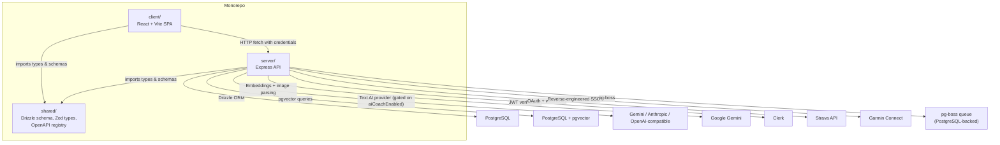
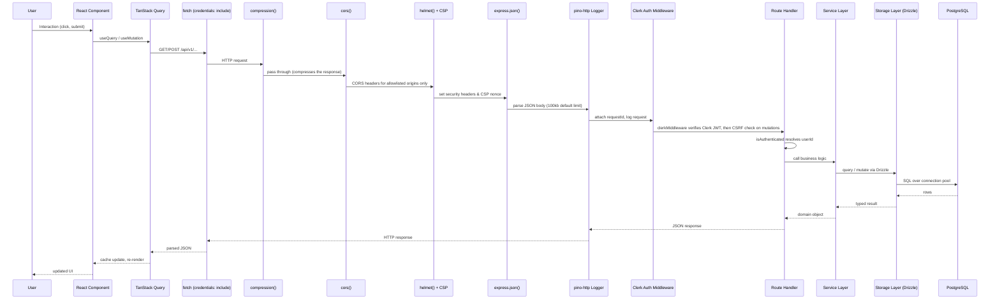
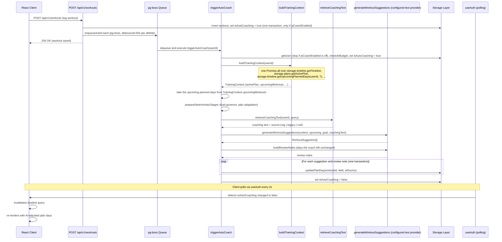
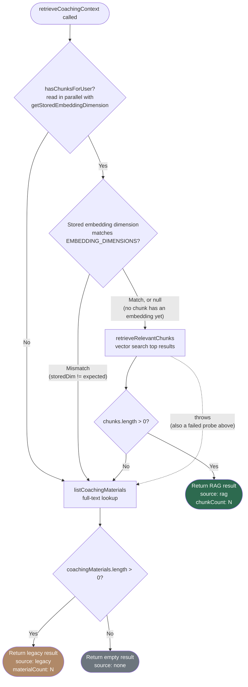
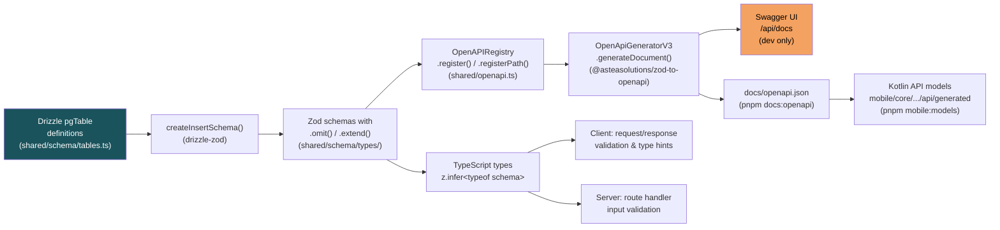
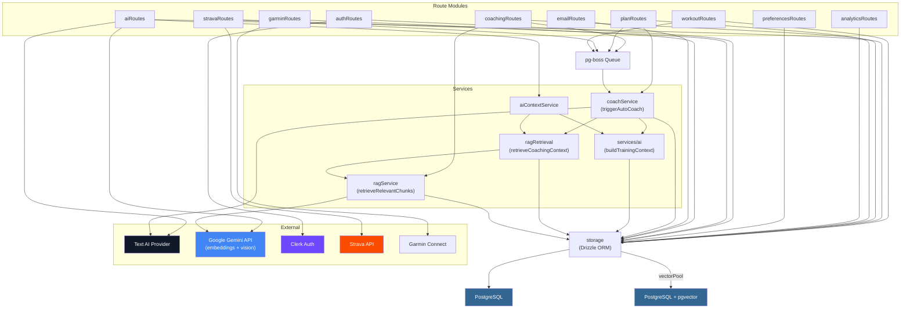
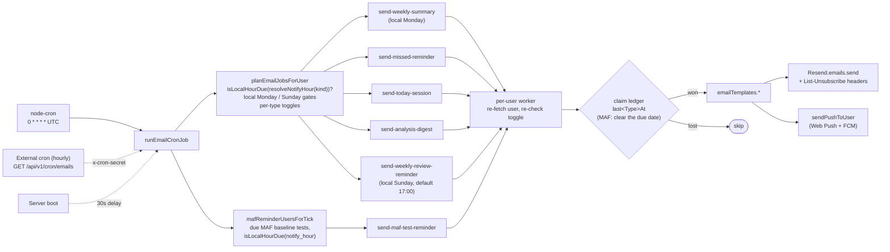

[Back to README](../README.md)

# Architecture Guide

This document describes the high-level architecture of the fitai.coach project -- a full-stack TypeScript monorepo combining a React frontend, an Express API server, PostgreSQL with pgvector, a modular text AI provider layer, Gemini embeddings and vision parsing, Clerk authentication, Strava and Garmin Connect activity sync, and a GDPR-compliant opt-in consent model for every outbound data flow.

---

## 1. Overview

The repository is organized into three top-level source directories that share a common TypeScript toolchain:

```
Hyrox-Companion/
  client/          React SPA (Vite, wouter, TanStack Query, Clerk React SDK)
  server/          Express API (Clerk Express SDK, Drizzle ORM, pg-boss, AI providers)
  shared/          Code shared between client and server (schema, OpenAPI, types)
```

A fourth directory, `mobile/`, holds the Kotlin Android app. It has its own Gradle build and calls the same `/api/v1` API with an `Authorization: Bearer` token instead of a session cookie. Its API models are generated from `docs/openapi.json` (`pnpm mobile:models`, see §5).



**Key conventions:**
- All API routes live under `/api/v1/` (outside it are only the dev-only Swagger UI at `/api/docs` and `/.well-known/assetlinks.json`).
- The client is served by Vite in middleware mode inside the Express process in development (`server/vite.ts`) and as static files in production (same origin as the API either way).
- `shared/` is imported directly by both `client/` and `server/` via TypeScript path aliases -- there is no separate build step.

---

## 2. Request Lifecycle

Every authenticated request follows this path from the browser to the database and back.



**Middleware stack order** (as registered in `server/index.ts`):

1. `compression()` -- gzip/brotli response compression (skipped for `text/event-stream`)
2. `GET /api/v1/health` -- health endpoint, registered **before CORS** so platform probes always reach it
   (`GET /.well-known/assetlinks.json`, the Android app's Digital Asset Links, is registered at the same point)
3. `cors()` -- origin allowlist with `credentials: true`
4. CSP nonce middleware -- per-request nonce for `<script>` tags (production only)
5. `helmet()` -- security headers, including the full Content-Security-Policy (Clerk/Strava/Sentry origins + per-request nonce) built by `buildCspDirectives()` in `server/middleware/csp.ts`, plus HSTS with preload, X-Frame-Options, etc.
6. Permissions-Policy header
7. `express.json()` -- body parsing with a 100kb limit. The routes that take more (1mb for `/api/v1/plans/import`, 2mb for `/api/v1/coaching-materials`, 5mb for coach chat sends, 10mb for image-parse routes) are skipped here and parsed inside their protected route stack, after auth and the route's rate limiter (`server/largeBodyParsers.ts`)
8. `express.urlencoded()` -- form body parsing (100kb limit)
9. `cookieParser()` -- required by the CSRF double-submit middleware
10. `pino-http` -- structured request logging; it runs before Clerk auth, so `req.log` carries `userId: "anonymous"` and only the completion line of a failed (>= 400) request logs the real Clerk user id
11. request-context wiring -- async context carrying `requestId` only
12. Route handlers (registered via `registerRoutes`)

`registerRoutes()` first installs `clerkMiddleware()` via `setupAuth()` (`server/clerkAuth.ts`, when Clerk keys are configured), so Clerk JWT verification runs after everything above. It then mounts `appVersionGate` on `/api/v1` (outdated native builds get 426 `APP_UPDATE_REQUIRED`), the `GET /api/v1/csrf-token` issuer and the Strava webhook and email-unsubscribe routes (which carry no CSRF token), then `csrfProtection` and `invalidateTrainingContextOnWrite` on `/api/v1`, then the route modules; idempotency runs per protected mutating route via the `protectedRouteBuilder` guards rather than as a global middleware.

---

## 3. Auto-Coach Pipeline

When a user logs a workout, the auto-coach pipeline adjusts upcoming plan days using AI. The pipeline is queue-driven via pg-boss to avoid blocking the request. The diagram follows the workout-create trigger; the other triggers are listed under Key details.



**Key details:**
- **Triggers**: `enqueueAutoCoach()` (`server/services/autoCoachQueue.ts`) is the single producer, called when a workout is created, a workout's date changes, logged sets are edited, a plan day is completed, or a plan day is rescheduled. It uses pg-boss's debounce with a 60-second window keyed per athlete, so a burst of edits collapses into one pass.
- `triggerAutoCoach` returns without doing anything when the athlete's `aiCoachEnabled` is off. When the athlete is over their AI budget, no text AI provider is configured, or there are no upcoming planned days, it applies the rule-based stages only and makes no model call.
- `isAutoCoaching` is a boolean flag on the `users` table that the client polls to detect when coaching is complete. `useAuth` polls every 2 seconds while the flag is set and gives up after 5 minutes.
- The write transaction starts with `lockAutoCoachWriteTargets()` (`server/services/autoCoachWriteGuard.ts`): a per-athlete transaction-scoped advisory lock serializes passes that run at once on two instances, the target plan days are locked `FOR UPDATE`, and any day (or the plan adaptation) that changed since the pass read its snapshot is left alone.
- The pipeline uses a `try/finally` block to guarantee `isAutoCoaching` is reset to `false` even on failure.
- A failed model call (provider error, open circuit breaker, timeout, unreadable reply) is not read as "no changes": the rule-based stages (load governor, plan adaptation) and any safety note are still written, no "the plan still fits" review notes are, and the job fails so pg-boss retries it.
- Suggestions can either `replace` or `append` content to the `mainWorkout`, `accessory` or `notes` field of a plan day.
- The `aiSource` field on each plan day records whether the AI used RAG chunks (`"rag"`), legacy materials (`"legacy"`), or neither (`null`).
- Suggestions pass through a safety layer (`aiSafety.ts`) and a repeat-modification guard (`aiModificationGuard.ts`) that suppresses repeated AI fatigue/volume reductions on an unchanged workout. See [AI and RAG](./ai-and-rag.md) for the guard's fingerprinting logic.

---

## 3b. RAG Ingest Pipeline

Coaching materials (typed principles, or `.txt` / `.md` / `.csv` / `.pdf` / `.docx` files) are reduced to plaintext **in the browser**, posted as JSON, then chunked, embedded, and persisted on the **vector** pool. The read path (§4 below) queries the same `document_chunks` table that this pipeline writes.

```mermaid
sequenceDiagram
    participant Client as React Client (useCoachingUpload)
    participant Upload as POST /api/v1/coaching-materials
    participant Queue as pg-boss Queue
    participant Embed as embedCoachingMaterial
    participant Gemini as generateEmbeddings (Gemini)
    participant Vector as document_chunks (vectorPool)
    participant Cache as retrieval cache

    Client->>Client: extract text in the browser (pdfjs-dist / mammoth / file.text())
    Client->>Upload: POST JSON { title, content, type }
    Upload->>Upload: AI consent + budget guards, validate, insert coaching_materials row
    Upload->>Queue: enqueue embed-coaching-material { materialId, userId }
    Upload-->>Client: 201 Created (the new coaching_materials row)

    Queue->>Embed: dequeue { materialId, userId }, load the row (skip if gone or AI consent is off)
    Embed->>Embed: chunkText(content) sized by RAG_CHUNK_SIZE / RAG_CHUNK_OVERLAP
    Note over Embed: title prefixed to chunk 0's embedding input only<br/>throws above MAX_CHUNKS_PER_MATERIAL

    Embed->>Gemini: generateEmbeddings(unique texts)
    Gemini-->>Embed: embedding vectors

    Embed->>Vector: transaction: delete old chunks, insert new
    Embed->>Embed: re-read the material; if deleted meanwhile, purge its chunks
    Embed->>Cache: invalidate user's retrieval cache

    Note over Queue,Embed: Uses DEFAULT_JOB_OPTIONS (retryLimit 3,<br/>exponential backoff) — handler is idempotent<br/>by materialId.
```

**Key details:**
- **Parsing happens in the browser**: `useCoachingUpload` (`client/src/components/settings/coaching/useCoachingUpload.ts`) lazy-loads `pdfjs-dist` for PDF and `mammoth` for DOCX and reads other files with `file.text()`, then sends only the extracted text. The server never receives the original file; the route accepts JSON `{ title, content, type }` (`type` is `principles` or `document`) under a 2 MB body limit. `coaching_materials` has no status column: the response is the created row, and embedding progress is derived from `document_chunks` (per-material `chunkCount` / `hasEmbeddings` in `GET /api/v1/coaching-materials/rag-status`).
- **Chunking**: `chunkText()` in `server/services/ragService.ts` prefers paragraph / sentence boundaries (`\n\n`, `. `) to keep semantic units intact, with `RAG_CHUNK_OVERLAP` characters bridging adjacent chunks for context continuity.
- **Dimension awareness**: no dimension is stored as such; `getStoredEmbeddingDimension()` (`server/storage/coaching.ts`) counts the components of one of the athlete's stored vectors, so the retrieval path (§4) can detect a model change and fall back to legacy full-text materials when the dimensions mismatch.
- **Idempotency**: re-enqueuing the same `materialId` replaces the existing chunks in a single transaction so the UI never observes a material in a half-embedded state.

---


## Route Declaration Convention (Protected Mutations)

All protected mutating endpoints in `server/routes/` and `server/routes/workouts/` must be declared with `protectedRouteBuilder` helpers, not direct middleware stacks.

**Required builder usage**
- `protectedPost(router, path, options, handler)` for protected `POST` mutations.
- `protectedPatch(router, path, options, handler)` for protected `PATCH` mutations.
- `protectedDelete(router, path, options, handler)` for protected `DELETE` mutations.

**Canonical guard order (enforced by tests):**
1. auth/idempotency guards (`protectedMutationGuards`)
2. rate limiter
3. large-body JSON parser (`largeJsonBodyParser`; a no-op except on the few large-body paths)
4. AI consent/budget guards (when enabled)
5. validation middleware
6. custom middleware
7. async handler wrapper

```ts
// ✅ Required pattern
protectedPost(router, "/api/v1/workouts", {
  limiter: rateLimiter("workout", 40),
  middleware: [validateBody(createWorkoutRouteSchema)],
}, async (req, res) => {
  // handler body
});

// ❌ Avoid direct stacking on protected mutations
router.post("/api/v1/workouts", isAuthenticated, rateLimiter("workout", 40), asyncHandler(handler));
```

A compliance test in `server/routes/__tests__/protectedRouteBuilderCompliance.test.ts` fails CI if protected mutating routes bypass the builder.

---

## 4. RAG Retrieval Decision Tree

The RAG retrieval system (`server/services/ragRetrieval.ts`) determines whether to use vector search, legacy full-text materials, or neither when building coaching context.



**Fallback reasons tracked in `ragInfo.fallbackReason`** (each value starts with one of these codes, followed by `: ` and a detail string; it is unset when the athlete simply has no chunks):
- `dimension_mismatch` -- stored embeddings were generated with a different model dimension; user must re-embed via settings.
- `no_embeddings` -- chunks exist but have no embedding vectors yet.
- `no_matching_chunks` -- vector search returned zero results for the query.
- `retrieval_error` -- an exception occurred during the chunk and dimension probes or the vector search.

In production, `sanitizeRagInfo` strips `chunks` and `fallbackReason` from API responses to avoid leaking internal diagnostics.

---

## 5. Schema Pipeline

Type safety flows from the database schema all the way to the Swagger UI documentation through a chain of code generation steps.



**Step-by-step:**

1. **Drizzle table definitions** (`shared/schema/tables.ts`) -- `pgTable()` calls define columns, types, indexes, and constraints. A custom `vector()` type maps PostgreSQL `vector(N)` to TypeScript `number[]`.
2. **drizzle-zod generation** -- `createInsertSchema()` auto-generates a Zod schema from a Drizzle table, handling column types, nullability, and defaults. `shared/schema/zod.ts` binds it to the project's `z` instance with `createSchemaFactory()`, after `extendZodWithOpenApi(z)` has run, so every generated schema carries the `.openapi()` extension.
3. **Zod refinement** (the modules under `shared/schema/types/`, re-exported by `shared/schema/types.ts`) -- `.omit({ id: true })` removes server-generated fields; `.extend()` adds stricter validation (e.g., `z.string().trim().min(1).max(255)` for a coaching material's title).
4. **OpenAPI registration** (`shared/openapi.ts` and the per-area path modules in `shared/openapiRoutes/`) -- Schemas are registered with `@asteasolutions/zod-to-openapi`'s `OpenAPIRegistry`, including path definitions with examples, the security scheme and the shared error envelopes. Request schemas are, where they can be, the same objects the route validation uses (e.g. `shared/schema/types/native.ts`), so the document cannot drift from what the server accepts; the exceptions are bodies whose route schemas depend on server-only code, such as the Web Push subscription bodies in `shared/openapiRoutes/push.ts`, which are described separately. `test/docs/openapiCoverage.test.ts` keeps registered routes and the document in step.
5. **Document generation** -- `OpenApiGeneratorV3` produces an OpenAPI 3.0 JSON spec from the registry (`generateOpenApiDocument()`). `pnpm docs:openapi` (`script/generate-openapi.ts`) writes it to `docs/openapi.json`, and the Build workflow fails when the committed snapshot differs from a fresh run. `pnpm mobile:models` (`script/kotlin-models/`) generates the Android app's Kotlin API models from that snapshot.
6. **Swagger UI** -- In development, `swagger-ui-express` serves interactive docs at `/api/docs` with a relaxed CSP.

---

## 6. Service Dependencies

The server is organized into route modules, service modules, and a storage layer. This diagram shows the dependency graph.



**Notable patterns:**
- **Route handlers** are thin orchestrators -- they validate input, delegate to use-case functions (e.g., `workoutUseCases.ts`), and return responses. The use-case layer separates transport concerns from business logic orchestration.
- **coachService** is the most connected service, depending on `services/ai` (`buildTrainingContext`), `ragRetrieval`, the configured text AI provider (through `server/gemini/`), the rule-based stages (`trainingLoadGovernor`, `planAdaptationService`), and the storage layer. The workout routes do not import it: they enqueue an `auto-coach` job and the queue worker calls `triggerAutoCoach`. The plan routes call it directly to regenerate one day's coach note (`regenerateCoachNoteForPlanDay`).
- **ragRetrieval** delegates vector search to `ragService`, which embeds the query with Gemini and reads `document_chunks` through the storage layer's separate connection pool (`vectorPool`). The coaching-material routes use `ragService` directly (RAG status, re-embed, cache clearing) and enqueue `embed-coaching-material` jobs.
- **pg-boss** uses the same PostgreSQL database for its job queue, keeping infrastructure simple.
- **Storage** is a single abstraction layer over Drizzle ORM, and most database access goes through it (including idempotency key caching via `IdempotencyStorage`). Code that needs its own transaction or a raw query imports `db` from `server/db.ts` directly, e.g. the auto-coach write in `coachService`, workout creation in `server/services/workoutService/workouts.ts`, the health rollup reads in `server/routes/analytics.ts`, and `server/garmin.ts`.
- **Nutrition** is a self-contained subsystem (`server/routes/nutrition/*`, `server/services/nutrition/*`) over the same storage layer. Food search fans out to external providers (Edamam, USDA, Open Food Facts) behind a relevance gate, with local `pg_trgm` fuzzy/synonym matching and an optional semantic-embeddings tier that reuses the `pgvector` pool; per-meal fuel targets are computed by the pure, DB-free `shared/mealFuelling.ts`. See [Nutrition & Fuelling](./nutrition.md).

---

## 7. Cron → Notification Pipeline

The notification pipeline is split across three runtimes: `node-cron` ticks every hour in UTC, the tick plans and enqueues per-user jobs into pg-boss against each athlete's own wall clock, and the queue workers send email through Resend plus push notifications (Web Push to browser subscriptions, FCM to registered app installs) through `sendPushToUser()` in `server/pushNotifications.ts`. Splitting the work this way means one user's slow send cannot block the next user, and a worker crash mid-batch only loses the in-flight job (the rest stay queued).



**Key details:**
- **Hourly UTC tick, per-athlete local gate**: `"0 * * * *"` in `server/cron.ts`. `planEmailJobsForUser()` (`server/emailScheduler.ts`) resolves each athlete's local hour and weekday from `users.user_timezone`. Each email kind has its own send hour, resolved by `resolveNotifyHour()` (`shared/notifyHours.ts`): the kind's optional `notify_hour_*` override, else the athlete's `notify_hour` (default 07:00). The exception is the weekly review reminder, which falls back to 17:00 instead. The hour test is `isLocalHourDue()`, so an hour that a spring-forward change removes from the athlete's day falls due on the first tick after the gap. On top of the hour, the weekly summary only goes out on the athlete's local Monday and the review reminder only on their local Sunday. Seventeen other crons live in the same process (idempotency cleanup 03:30, AI-usage log cleanup 04:00, shared runtime state cleanup 04:15, structured exercise health rollup 02:10, RAG chunk prune daily at 03:50, recycle-bin purge daily at 03:45, plan-day move prune daily at 03:55, analytics recompute hourly at :05 firing at each user's local midnight, account erasure sweep hourly at :35, nutrition push reminders hourly at :25, the food-embedding backfill every 30 minutes when semantic food search is enabled, stale `isAutoCoaching` recovery every 10 minutes, the stale plan-generation sweep every 10 minutes at :03, queue-depth telemetry every 5 minutes, the Strava auto-sync polling scan every 15 minutes, the session-stream backfill every 15 minutes, and the Strava webhook subscription check six-hourly and 30 s after boot). Each cron body runs under a Postgres advisory lock so only one replica performs the work when several are running.
- **Before planning**: each `runEmailCronJob` scan first marks past planned days as missed (`storage.plans.markMissedPlanDays()`), in parallel with loading the athletes who have email notifications on and those with a due MAF baseline test. The MAF reminder is planned from that second list, because its athletes may be push-only, and goes out at the athlete's `notify_hour`.
- **Startup catch-up**: `cron.ts` schedules one catch-up scan 30 s after every boot, as a one-shot timer (not a cron) under its own `startupEmailCatchUp` advisory lock. The per-user local-hour gate and the claim ledgers keep it idempotent, so it needs no time-of-day condition.
- **Claim before send**: every worker takes an atomic conditional `UPDATE` on its ledger column (`claimWeeklySummary` and friends in `server/storage/users.ts`) before building the email, with a window deliberately shorter than the cadence; only the winner sends. The MAF reminder is one-shot instead: `claimMafBaselineTest()` clears `maf_baseline_test_scheduled_at` if it is still set and due, and the winner sends the email only when the athlete has email notifications on (the push goes out either way).
- **Scoped retries**: the enqueue uses `sendJobNoRetry()` for the send legs because the ledger is stamped at claim time, so a retry after a post-send failure would deliver a duplicate email. Upstream jobs (parse / ingest) use `sendJob()` with the default `retryLimit: 3` because their handlers are idempotent by id.
- **No AI on the email path**: the analysis digest reads stored `analytics_results` rows only; recomputes stay with the `analyticsRecompute` cron.
- **Unsubscribe**: every send carries `List-Unsubscribe` / `List-Unsubscribe-Post` headers and a footer link to `/api/v1/emails/unsubscribe`, mounted ahead of the CSRF guard (see [integrations.md § One-Click Unsubscribe](integrations.md#one-click-unsubscribe)).
- **External trigger**: the same `runEmailCronJob` can be invoked via `GET /api/v1/cron/emails` guarded by the `x-cron-secret` header, which must match `CRON_SECRET` — call it hourly when scheduling from Railway Cron or GitHub Actions instead of the in-process timer.
- **Per-job timeout**: every worker is wrapped in `runWithTimeout` (50 min, `JOB_TIMEOUT_MS`) so a hung Resend or Gemini call cannot leak a worker slot indefinitely.
- **Same pattern, different payload — stored-first analytics**: the `analyticsRecompute` cron reuses this exact fixed-UTC-tick → local-time-gate → pg-boss → worker shape. It ticks hourly, fires per user at local midnight, and enqueues `recompute-analytics` jobs that refresh the durable `analytics_results` row (Coach Insights / Race Prediction) so the next open paints a fresh result with no AI spend on the read path. See [integrations.md § Analytics Recompute](integrations.md#analytics-recompute-scan).
- See [integrations.md § Email](integrations.md#email-system-resend) for the prose walkthrough and [integrations.md § Job Queue](integrations.md#job-queue-pg-boss) for the queue-level details.

---

## 8. Cross-References

Detailed documentation for each subsystem:

| Document | Description |
|---|---|
| [Client Architecture](./client.md) | React components, routing (wouter), lazy loading, theme, sidebar layout |
| [Server Architecture](./server.md) | Express setup, middleware stack, route registration, error handling |
| [Database](./database.md) | Drizzle schema, migrations, tables, indexes, pgvector setup |
| [AI and RAG](./ai-and-rag.md) | Gemini integration, embedding pipeline, vector search, prompt construction |
| [Nutrition & Fuelling](./nutrition.md) | Food logging, search (fuzzy/synonym/semantic), per-meal fuel targets, external food sources, AI meal parsing |
| [State Management](./state-management.md) | TanStack Query, cache invalidation, optimistic updates, polling |
| [API Reference](./api-reference.md) | Endpoint catalog, request/response shapes, status codes |
| [Authentication](./authentication.md) | Clerk setup, JWT verification, dev auth bypass, webhook sync |
| [Integrations](./integrations.md) | Strava OAuth, activity sync, pg-boss queue, Resend email, Sentry |
| [Testing](./testing.md) | Test strategy, Cypress E2E, Vitest unit tests, CI pipeline |
