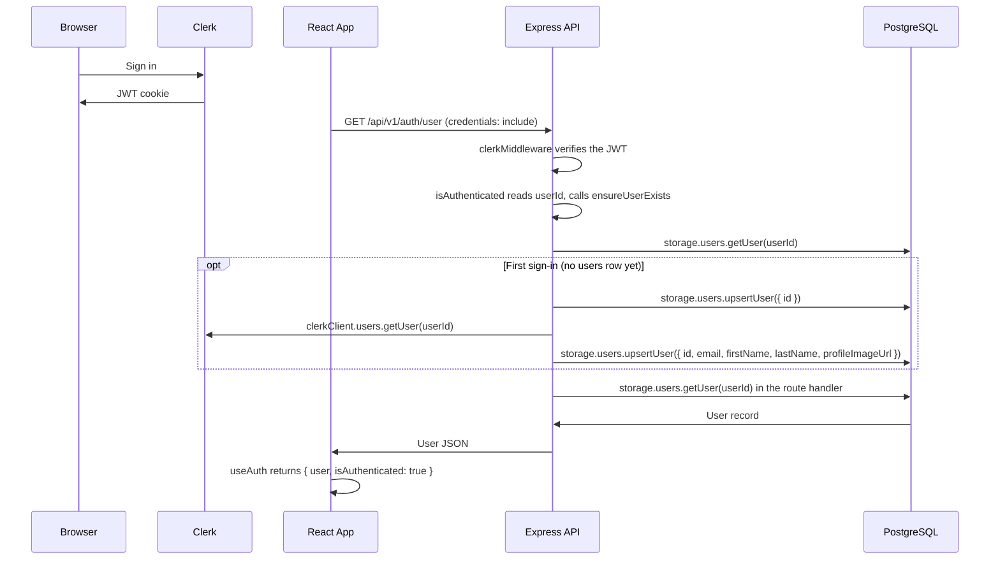

# Authentication System

## Overview

The fitai.coach app uses [Clerk](https://clerk.com) for authentication. Clerk provides JWT-based identity management on both the client (via `@clerk/react`) and the server (via `@clerk/express`). A development auth bypass mode exists for local development, Cypress testing, and iframe preview contexts.

The authentication flow works as follows:

1. The client authenticates the user through Clerk's prebuilt sign-in modal (`<SignInButton mode="modal">` on the landing page).
2. Clerk issues a JWT that is automatically attached to every API request via session cookies. The native Android app has no cookies and sends the same session token in an `Authorization: Bearer` header instead (see [Bearer-Token Clients](#bearer-token-clients-native-app)).
3. The server validates the JWT using Clerk middleware and extracts the `userId`.
4. On the first authenticated API call, the server syncs the Clerk user profile into the application database.

---

## Client-Side Auth

**Key file:** `client/src/App.tsx`

### ClerkProvider

The entire application is wrapped in a `<ClerkProvider>` component from `@clerk/react`, initialized with the publishable key from the `VITE_CLERK_PUBLISHABLE_KEY` environment variable:

```tsx
<ClerkProvider publishableKey={clerkPubKey}>
  <BaseProviders>{appShell}</BaseProviders>
</ClerkProvider>
```

`BaseProviders` holds the `QueryClientProvider`, `ThemeProvider` and `TooltipProvider`. When the dev auth bypass is active, `ClerkProvider` is omitted entirely and the app renders `<BaseProviders>` alone, without any Clerk context.

### Conditional Rendering with Show

The `<Show>` component from `@clerk/react` gates access to the authenticated application. When the user is signed in, `<AuthenticatedLayout>` renders. Otherwise the fallback renders a small signed-out router: `/privacy` and `/delete-account` show their pages, and every other path shows the `<Landing>` page:

```tsx
<Show
  when="signed-in"
  fallback={
    <Suspense fallback={<LazyFallback />}>
      <Switch>
        <Route path="/privacy"><Privacy /></Route>
        <Route path="/delete-account"><DeleteAccount /></Route>
        <Route><Landing /></Route>
      </Switch>
    </Suspense>
  }
>
  <AuthenticatedLayout />
</Show>
```

### useAuth Hook

**Key file:** `client/src/hooks/useAuth.ts`

The custom `useAuth` hook abstracts over two implementations:

- **`useClerkAuthImpl`** -- The production path. Uses `useAuth` and `useUser` from `@clerk/react` to determine sign-in status. Once signed in, it fetches the database user record via a `useQuery` call to `/api/v1/auth/user`. Returns a composite user object that falls back to Clerk profile data while the database user loads.

- **`useTestAuthImpl`** -- The bypass path. Skips Clerk entirely and immediately fetches the database user from `/api/v1/auth/user`. Considers the user authenticated as soon as a database record is returned.

The hook export is selected at module load time:

```ts
export const useAuth = shouldBypassAuth() ? useTestAuthImpl : useClerkAuthImpl;
```

### Request Credentials

All API requests include `credentials: "include"` so that Clerk session cookies are sent with every fetch. This is configured in the shared `apiRequest` function and the default `queryFn` in `client/src/lib/queryClient.ts`.



---

## Server-Side Auth

**Key file:** `server/clerkAuth.ts`

### setupAuth

The `setupAuth` function is called during server startup and configures authentication middleware on the Express app:

1. **Clerk keys present** -- Installs `clerkMiddleware()` from `@clerk/express`, which parses and validates Clerk JWTs on every incoming request.
2. **No Clerk keys, dev bypass enabled** -- Skips Clerk middleware and seeds a hardcoded dev user in the database.
3. **No Clerk keys, no bypass** -- Throws. `setupAuth` runs inside `registerRoutes`, after the HTTP server is already listening, so the process stays up but startup fails in the `routes` phase: no API route is mounted and the health endpoints answer `503`.

If the dev bypass is enabled (regardless of whether Clerk keys are also present), the dev user is always seeded as a fallback.

### isAuthenticated Middleware

The `isAuthenticated` request handler is applied to all protected routes. It runs in this order:

1. If Clerk keys are configured, call `getAuth(req)` from `@clerk/express` to extract the `userId` from the validated JWT. If a `userId` is present, sync the user to the database (see User Sync Flow below) and proceed. Two failures end the request here: an account that was just erased gets the same `401` as step 3, and any other sync error gets `500 { "error": "Failed to initialize user session", "code": "INTERNAL_SERVER_ERROR" }`.
2. If Clerk auth fails and the dev bypass is enabled, fall through to the dev user identity (unless the request carries an `x-test-no-bypass: true` header, used for testing 401 behavior). The dev user row is created if it is missing; a failure there is a `500`.
3. Otherwise, return a `401 Unauthorized` JSON response.

### getUserId Helper

**Key file:** `server/types.ts`

The `getUserId(req)` function extracts the authenticated user's ID from a request:

```ts
export function getUserId(req: Request): string {
  try {
    const auth = getAuth(req);
    if (auth?.userId) {
      return auth.userId;
    }
  } catch {
    // intentionally empty - fall through to dev user
  }

  if ((env.NODE_ENV === "development" || env.NODE_ENV === "test") && env.ALLOW_DEV_AUTH_BYPASS === "true") {
    return DEV_USER_ID;
  }

  throw new Error("User not authenticated");
}
```

Note the environment check is `development` **or** `test` — the Cypress job boots the
built server with `NODE_ENV=test` and `ALLOW_DEV_AUTH_BYPASS=true`, so the bypass has to
hold there too. Production is excluded twice over: this check, and the startup guard that
exits the process outright (see [Production Safety Guards](#production-safety-guards)).

Route handlers use this to obtain the current user's ID after the `isAuthenticated` middleware has already verified authentication.

---

## User Sync Flow

**Key files:** `server/clerkAuth.ts`, `server/storage/users.ts`

When a Clerk-authenticated request passes through `isAuthenticated`, the middleware calls `ensureUserExists(clerkUserId)`:

1. **Check the user-seen cache.** A user-seen cache (5-minute TTL) tracks users whose row this server recently confirmed. The cache is layered: a per-process in-memory `Map` (capped at 10,000 users, least recently seen dropped first), backed by a shared `server_runtime_cache` table so multiple instances share the signal. A hit in the `Map` returns immediately (no DB or remote call); a miss there costs one read of the shared table, and a hit in it also returns. Under `NODE_ENV=test` only the `Map` is used.
2. **Check the database.** On a cache miss, look up the user row by ID. If a row already exists, mark the user seen and return.
3. **Refuse an erased account.** If there is no row and the ID carries an `auth-erased` tombstone (see [Account Deletion](#account-deletion)), throw instead of provisioning; `isAuthenticated` answers `401`.
4. **Provision a minimal row.** Otherwise upsert a minimal `users` row containing only the Clerk user ID, then call `hydrateClerkProfile()` to fill in the rest.
5. **Hydrate the Clerk profile.** `hydrateClerkProfile()` fetches the full profile from Clerk's API via `clerkClient.users.getUser(clerkUserId)`, bounded by a 15-second timeout (`EXTERNAL_API_TIMEOUT_MS` in `server/constants.ts`, applied with `Promise.race` since the Clerk SDK does not accept an `AbortSignal`). It then upserts the `users` row with:
   - `id` -- The Clerk user ID
   - `email` -- The primary email address, or the first address on the Clerk user when none is marked primary
   - `firstName`, `lastName` -- Name fields
   - `profileImageUrl` -- Avatar URL
   If the Clerk fetch fails or times out, the minimal row is left in place (the warning is logged and the request proceeds).

The `upsertUser` method in `UserStorage` uses an `INSERT ... ON CONFLICT DO UPDATE` query, but `ensureUserExists` only hydrates the profile when it has just created the row. Once a row exists, a later change to the name, email or avatar in Clerk is not copied to it, and a hydration that failed is not retried. If the upsert hits the `users_email_unique` constraint (the email already belongs to a different user), the profile is re-upserted without the `email` field so provisioning still succeeds.

For the dev bypass path, a similar `ensureDevUserExists` function creates a user with the hardcoded ID `"dev-user"`, email `dev@localhost`, and name `Dev User`.

---

## Dev Auth Bypass

The dev auth bypass allows the app to run without Clerk credentials. On the server it is controlled by the `ALLOW_DEV_AUTH_BYPASS` environment variable and is protected by multiple guards to prevent accidental use in production. The client never reads that variable; it decides separately, from the conditions below.

### Activation Conditions

The bypass activates when any of the following client-side conditions are met (evaluated in `client/src/lib/authBypass.ts`, used by `client/src/App.tsx`, `client/src/hooks/useAuth.ts` and `client/src/hooks/useSignOut.ts`):

- **Cypress tests** -- `window.Cypress` is defined.
- **Dev preview** -- The app is running in Vite dev mode (`import.meta.env.DEV`) AND either the `VITE_CLERK_PUBLISHABLE_KEY` is missing or the page is loaded inside an iframe (`window.self !== window.top`).

On the server, the bypass activates when:

- `ALLOW_DEV_AUTH_BYPASS` is `"true"` AND `NODE_ENV` is `"development"` or `"test"`.

### Production Safety Guards

Three independent layers prevent the bypass from being used in production:

1. **Zod schema refinement** (`server/env.ts`) -- The environment variable schema includes a `.refine()` rule that rejects the combination of `NODE_ENV=production` and `ALLOW_DEV_AUTH_BYPASS=true`. The server will not start if this validation fails.

2. **Startup guard** (`server/index.ts`, the block marked `// 🛡️ Sentinel: Dev Auth Bypass double-guard`) -- An explicit check near the top of the server entrypoint. If `ALLOW_DEV_AUTH_BYPASS=true` and `NODE_ENV=production`, the server logs a fatal message and calls `process.exit(1)`; in any other environment it logs a warning instead.

3. **Runtime guard** (`server/clerkAuth.ts`) -- The `isDevBypassEnabled()` function returns `false` unconditionally when `NODE_ENV` is `"production"`, regardless of the `ALLOW_DEV_AUTH_BYPASS` value.

All three key on `NODE_ENV`, so a further `server/env.ts` refinement covers a production deploy that forgot to set it: a `CLERK_PUBLISHABLE_KEY` starting with `pk_live_` with `NODE_ENV` other than `production` fails startup.

### Hook Selection Logic

The `useAuth` export is determined at module load time (not runtime):

```typescript
// client/src/lib/authBypass.ts
export function shouldBypassAuth(): boolean {
  return isCypressTest() || isDevPreview();
}

// client/src/hooks/useAuth.ts
export const useAuth = shouldBypassAuth() ? useTestAuthImpl : useClerkAuthImpl;
```

- `useClerkAuthImpl`: Uses `@clerk/react` hooks (`useAuth`, `useUser`). Fetches DB user via React Query when `isSignedIn`. Falls back to Clerk profile while DB loads.
- `useTestAuthImpl`: Skips Clerk entirely. Fetches DB user directly (server uses hardcoded `dev-user` ID).
- Both implementations share `useCoachingPollInterval()` for auto-coach polling and `useAutoCoachWatcher()` for timeline invalidation.

### Behavior When Active

- **Client:** `ClerkProvider` is not rendered. The `<Show>` gate is skipped and `<AuthenticatedLayout>` renders directly. An amber "DEV MODE" banner appears at the top of the page in dev preview mode. The `useTestAuthImpl` hook is used instead of `useClerkAuthImpl`, and `useSignOut` only clears this device's local data, since there is no Clerk session to end.

- **Server:** The `isAuthenticated` middleware falls through to the dev user path when Clerk auth is not present. Every request without a Clerk identity is treated as coming from the `"dev-user"` identity. The `x-test-no-bypass: true` request header can be used to opt out of the bypass for specific requests (useful for testing unauthenticated behavior).

- **Cypress:** Specs that call `setupAuthIntercepts()` (`cypress/support/authIntercepts.ts`) stub `GET /api/v1/auth/user` and `GET /api/v1/csrf-token` with fixtures, so the athlete those specs see is `test-user-123` rather than `dev-user`.

---

## Route Protection

**Key files:** `server/routes/auth.ts`, `server/clerkAuth.ts`, `server/routeUtils.ts`

Every `/api/v1/*` route is protected by the `isAuthenticated` middleware except these endpoints, which have to be reachable without a Clerk session:

- `GET /api/v1/health` and `GET /api/v1/health/live` -- platform health probes (`server/bootstrap/health.ts`)
- `GET /api/v1/csrf-token` -- CSRF token issuance
- `GET /api/v1/strava/callback` -- the Strava OAuth redirect, authorised by the signed, single-use OAuth `state` plus the browser-binding cookie `/strava/auth` set, so only the browser that started the flow can complete it
- `GET`/`POST /api/v1/strava/webhook` -- Strava webhook deliveries, which the handler treats as hints only (`server/stravaWebhook.ts`)
- `GET`/`POST /api/v1/emails/unsubscribe` -- email unsubscribe, authorised by the signed unsubscribe token
- `GET /api/v1/cron/emails` -- the external email-cron trigger, authorised by an `x-cron-secret` header matching `CRON_SECRET`

Every other route applies `isAuthenticated` explicitly, either directly or, for protected mutations, through `protectedMutationGuards` (`server/routeGuards.ts`):

```ts
const AUTH_USER_RATE_LIMIT_PER_MIN = 60; // covers the 2 s auto-coach poll (30/min)

router.get('/api/v1/auth/user', isAuthenticated, rateLimiter("auth", AUTH_USER_RATE_LIMIT_PER_MIN), asyncHandler(async (req, res) => {
  const userId = getUserId(req);
  const user = await storage.users.getUser(userId);
  res.json(user);
}));
```

The middleware chain for a typical protected route is:

1. `clerkMiddleware()` (global, if Clerk keys are present) -- Parses the JWT and attaches auth data to the request.
2. `appVersionGate` (global on `/api/v1`, `server/middleware/appVersion.ts`) -- Answers `426` with code `APP_UPDATE_REQUIRED` to a native app build older than `MIN_APP_VERSION_ANDROID` / `MIN_APP_VERSION_IOS`. Requests without an `X-App-Platform` header (the web app) pass untouched.
3. `csrfProtection` (global on `/api/v1`, mounted in `server/routes.ts` as `app.use("/api/v1", csrfProtection)`) -- Verifies the `x-csrf-token` header against the signed cookie on mutating requests. Safe methods (`GET`/`HEAD`/`OPTIONS`) pass through.
4. `isAuthenticated` (per-route) -- Validates that the request has a valid user identity and syncs the user to the database. Returns `401` if unauthenticated. On mutations, `protectedMutationGuards` follows it with `idempotencyMiddleware`, which replays the stored response for a repeated `X-Idempotency-Key`.
5. `rateLimiter(category, max)` (per-route) -- Applies per-user rate limiting, keyed by `userId` (by client IP when the request has no Clerk identity) and backed by shared Postgres buckets outside tests.
6. `asyncHandler(fn)` -- Wraps the route handler to catch async errors and forward them to Express error handling.

Unauthenticated requests receive:

```json
{ "error": "Unauthorized", "code": "UNAUTHORIZED" }
```

with HTTP status `401`.

---

## CSRF Protection

**Key file:** `server/middleware/csrf.ts`

The application uses CSRF protection via the `csrf-csrf` library (double-submit cookie pattern) to prevent cross-site request forgery on the state-changing `/api/v1` endpoints. Two `POST` receivers mount ahead of the guard in `server/routes.ts` because their callers can hold neither cookie nor token: the Strava webhook and the email unsubscribe link. This complements Clerk's cookie-based JWT auth.

### Integration with Clerk Auth

- The CSRF token is bound to the Clerk `userId` as the session identifier (via `getSessionIdentifier`). This means tokens issued before login are invalidated after sign-in, and tokens cannot be replayed across users.
- On the client side, the cached CSRF token is reset on any Clerk sign-in state transition. The `useClerkAuthImpl` hook tracks the previous `isSignedIn` value with a `useRef` and calls `resetCsrfToken()` whenever it flips, forcing a fresh token fetch after authentication transitions.
- For pre-login requests (where Clerk auth hasn't run yet), the session identifier falls back to the client IP address.

### Key Separation (CSRF_SECRET vs. ENCRYPTION_KEY)

`CSRF_SECRET` is **required** in production, and whenever it is set it **must be distinct** from `ENCRYPTION_KEY`, in every environment. Both constraints are enforced at startup in `server/env.ts` via Zod `.refine()` checks that hard-fail boot with explicit messages:

- `"❌ FATAL: CSRF_SECRET is required in production"`
- `"❌ FATAL: CSRF_SECRET must differ from ENCRYPTION_KEY for proper key separation"`

Mixing the two keys would tie the HMAC used for CSRF token signing to the same secret that decrypts Strava/Garmin credentials; rotating one would force the other. In development/test, `CSRF_SECRET` may be omitted: `resolveCsrfSecret()` in `server/middleware/csrf.ts` then generates a random per-process secret and logs a warning. It never falls back to `ENCRYPTION_KEY`.

### Client Flow

1. On the first mutating request (and again after `resetCsrfToken()` clears the cache), `apiRequest()` in `client/src/lib/queryClient.ts` calls the unprotected `GET /api/v1/csrf-token` endpoint to obtain a CSRF token. Nothing is fetched on app load. The server returns the token in JSON and sets the paired signed httpOnly cookie (`__Host-fitai.x-csrf` in production, `fitai.x-csrf` in development).
2. The token is cached in memory and attached as the `x-csrf-token` header on all mutating requests.
3. If a mutation gets a 403 that may be a CSRF rejection, it refetches the token once and retries the request. csrf-csrf answers a bad token with code `EBADCSRFTOKEN`, so a 403 naming any other code (`AI_COACH_DISABLED`, say) is surfaced without the retry. A 403 with no code, or a body that is not JSON, is still retried.

### Bearer-Token Clients (Native App)

The native mobile app ([mobile-app-plan.md](mobile-app-plan.md)) sends no cookies. It authenticates with the Clerk session token from the Clerk Android SDK in an `Authorization: Bearer` header, which `clerkMiddleware()` already verifies; Clerk reads a header token ahead of any session cookie. `csrfProtection` skips the double-submit check for such a request (`bearerAuthState()` in `server/middleware/csrf.ts`), because a bearer token is never attached by the browser on its own and a cross-site page cannot add the header without a CORS preflight the origin allowlist refuses. The exemption is narrow:

- A request that also carries a Clerk session cookie (`__session` or `__session_<suffix>`) keeps the check, so the cookie-authenticated web app is exactly as protected as before.
- With no Clerk middleware installed (the dev auth bypass without keys) nothing is exempt.
- A mutating request whose bearer token Clerk rejects is answered `401 { "error": "Unauthorized", "code": "UNAUTHORIZED" }` — what `isAuthenticated` would have said — rather than a CSRF error, so the app refreshes its token instead of looking for a cookie it never has.

See [Server -- CSRF Protection](server.md#csrf-protection) for full implementation details.

---

## Account Deletion

**Key files:** `server/routes/account.ts` (the route) and `server/services/accountErasureService.ts` (the steps). They are separate because the erasure has to be resumable — see the [runbook](operations/account-erasure.md).

The `DELETE /api/v1/account` endpoint is the GDPR "right to erasure" entry point. It deliberately sequences the erasure marker, the vector-DB purge, Clerk identity removal, Strava deauthorization, DB cascade delete, and auth-cache eviction so that no ordering can leave the user's data partially alive.

### Order of Operations

1. **Stamp `users.erasure_requested_at`.** Written before anything irreversible. Deleting the Clerk identity (step 3) is a point of no return — past it the athlete can no longer authenticate to retry — so a run that dies afterwards leaves this marker for the sweep below to finish. A run that fails before that point (in step 2, or when Clerk declines the delete with a 4xx other than 404) withdraws the stamp it wrote (`withdrawErasureStamp`), so the sweep does not later finish a deletion the athlete was told had failed. A stamp left by an earlier run is kept.

2. **Purge the vector DB.** The user's RAG chunks and their private foods' embeddings live on a separate `vectorPool` database that the main-DB cascade cannot reach, so they are deleted explicitly, fail-loud, before any irreversible step. The user's cached RAG retrievals, which hold excerpts of those chunks in `server_runtime_cache`, are purged in the same fail-loud step (`purgeRagCacheForUser`).

3. **Delete the Clerk identity.** If the DB row were deleted before the Clerk identity, the user's next authenticated request would hit `ensureUserExists` and silently re-provision a fresh DB row ("undeleting" the account). Deleting Clerk before the DB row means no new session can be minted; a session token minted earlier still verifies until it expires, and is refused by the tombstone described in step 8. The call is skipped when `CLERK_SECRET_KEY` is not set.

4. **Clerk 404 is treated as success.** If `clerkClient.users.deleteUser(userId)` throws with `status === 404`, the handler logs `"Clerk user already deleted, continuing with DB cleanup"` and proceeds. This makes the endpoint idempotent for retries where a previous attempt succeeded at Clerk but failed at a later step. Any other Clerk error aborts the request so the DB row is left intact.

5. **Best-effort Strava deauthorization.** `POST https://www.strava.com/oauth/deauthorize` is called with the stored Strava access token. Failures are logged at `warn` and swallowed — the user's data is still deleted. (Garmin requires no equivalent call: `@flow-js/garmin-connect` has no server-side revocation; discarding the tokens is sufficient.)

6. **Delete the DB user row and the user's private custom foods, in one transaction.** FK `ON DELETE CASCADE` removes every child row, among them workouts, sets, plans, plan days, chat messages, coaching materials, Strava and Garmin connections, custom exercises, web push subscriptions and native device push tokens, AI usage logs, idempotency keys, timeline annotations, consents, and the nutrition logs, targets, favorites and recipes. (The coaching-material embeddings are not among them — they were purged in step 2.) Public custom foods survive by explicit opt-in. A private food that another athlete's rows still reference is handed to those athletes as their own private copy and the original deleted. The embeddings of the foods deleted here are then purged a second time, best-effort. If there was no user row to delete, the endpoint answers `404` and stops here.

7. **Best-effort purges.** The user's rate-limit buckets and any queued pg-boss jobs are removed; neither is FK-linked to `users`, so the cascade leaves them behind.

8. **Evict the auth seen-cache.** `evictUserFromSeenCache(userId)` clears the local and shared 5-minute `ensureUserExists` cache. Eviction on its own would *re-open* provisioning: Clerk verifies session JWTs locally, so a token minted before step 3 keeps authenticating for up to its lifetime (60 s by default), and with no row and no cache entry `ensureUserExists` would recreate the account. So straight after the Clerk identity is gone (before step 5) the erasure also writes a 10-minute `auth-erased` tombstone (`rememberUserErased`, local and shared runtime cache, fail-loud), and `ensureUserExists` refuses to provision while it stands, which `isAuthenticated` answers with a 401 (P5, CODEBASE_ANALYSIS_2026-10-03).

Rate-limited to 3 per minute under the `accountDelete` category — enough to retry a transient failure, not enough to mass-delete.

On success the web client clears this device's local data (`clearUserLocalData()`, see [Session Management](#session-management)) and reloads to `/` after 1.5 seconds (`client/src/components/settings/AccountDangerZone.tsx`).

**Stranded runs.** `runStrandedErasureSweep` (hourly cron, advisory lock `accountErasureSweep`) re-runs the same steps for any row still carrying `erasure_requested_at` past a 15-minute threshold, oldest first and at most 50 accounts per pass. Every step is idempotent, so replaying a partially-completed erasure is safe.

---

## Session Management

Clerk manages session lifecycle entirely. The app does not implement custom token storage or refresh logic.

- **Token delivery:** Clerk session cookies are included in every request via `credentials: "include"` on all `fetch` calls. The native app instead asks Clerk's Android SDK for the session token before each request and sends it as `Authorization: Bearer` (`ClerkAuth.token()` in `mobile/androidApp`, attached by `mobile/core`'s `ApiClient`).
- **Token refresh:** Handled automatically by the Clerk SDK. The `@clerk/react` provider monitors token expiration and refreshes tokens transparently.
- **Session state:** The `useAuth` / `useUser` hooks from `@clerk/react` expose reactive `isSignedIn` and `isLoaded` properties that update when the session state changes.
- **Sign-out:** `useSignOut` (`client/src/hooks/useSignOut.ts`) awaits `clearUserLocalData()` (`client/src/lib/userLocalData.ts`) and then calls Clerk's `signOut()`. The cleanup empties the offline write queue, removes this device's workout drafts, onboarding flag and cached analytics/AI snapshots from `localStorage` and `sessionStorage`, deletes the Workbox `api-cache`, and unsubscribes the browser's push subscription (server row first, while the session is still valid). The sidebar's Log out button goes through `useConfirmedSignOut`, which asks for confirmation first when offline writes are still queued.

The server configures Express's `trust proxy` setting in `server/bootstrap/appConfig.ts` (driven by the `TRUST_PROXY` env var) to ensure correct client IP detection behind reverse proxies, which is important for rate limiting and the CSRF session identifier's IP fallback.

---

## Environment Variables

| Variable | Required | Side | Description |
|---|---|---|---|
| `CLERK_PUBLISHABLE_KEY` | Optional* | Server | Clerk publishable key. Read from the environment by Clerk middleware on the server. A `pk_live_` key is rejected at startup unless `NODE_ENV` is `production`. |
| `CLERK_SECRET_KEY` | Optional* | Server | Clerk secret key. Used by `@clerk/express` to validate JWTs and by `clerkClient` to call the Clerk API (`users.getUser` when a user is provisioned, `users.deleteUser` in `/api/v1/account`). |
| `VITE_CLERK_PUBLISHABLE_KEY` | Optional* | Client | Clerk publishable key for the React client. Vite exposes this to the browser bundle. |
| `CSRF_SECRET` | Required in production** | Server | 32+ char secret for CSRF token HMAC. Must differ from `ENCRYPTION_KEY` in every environment (see [Key Separation](#key-separation-csrf_secret-vs-encryption_key)). When unset in dev/test, a random per-process secret is generated. |
| `ALLOW_DEV_AUTH_BYPASS` | Optional | Server | Set to `"true"` to enable the server-side dev auth bypass. Only permitted in `development` and `test` environments. Fatal in production. The client does not read it (see [Activation Conditions](#activation-conditions)). |

*The Clerk keys are optional in the Zod schema but are effectively required for production. If either server key is absent and `ALLOW_DEV_AUTH_BYPASS` is not `"true"`, `setupAuth` throws and startup fails (see [setupAuth](#setupauth)).

**Enforced at boot by `server/env.ts` `.refine()` guards: a missing `CSRF_SECRET` in production, or one equal to `ENCRYPTION_KEY` in any environment, aborts startup with an `❌ FATAL:` message.

---

See also: [Server -- Middleware Stack](server.md#middleware-stack), [Database -- Users Table](database.md#schema-tables)
