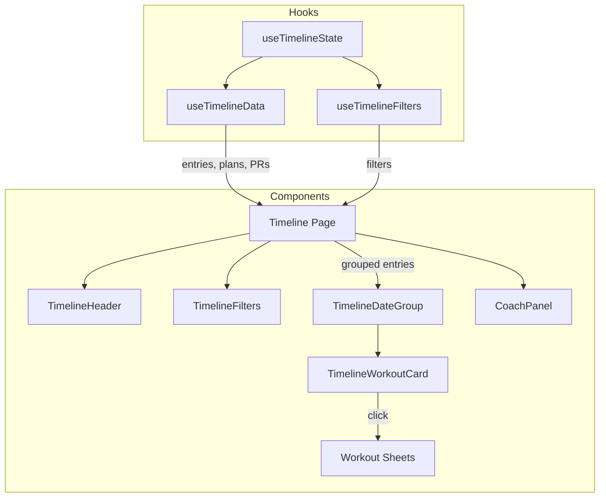

# Client Frontend Documentation

## Overview

The fitai.coach frontend is a single-page application for AI-powered fitness training planning, logging, and analytics. It is built with:

- **React 19** (via `react-dom/client` `createRoot`)
- **Vite 8** as the build tool and dev server
- **TypeScript 7** (native compiler for type-checking; TS 6 is kept installed for typescript-eslint — see CONTRIBUTING.md)
- **Tailwind CSS 4** (using `@tailwindcss/vite` plugin)
- **shadcn/ui** (New York style, Radix UI primitives)
- **wouter** for client-side routing
- **TanStack React Query** for server state management
- **Clerk** for authentication
- **Sentry** for error tracking
- **vite-plugin-pwa** for Progressive Web App support

The app is branded as **fitai.coach** and serves as an AI fitness coach that lets users import training plans, log workouts (with voice input and Strava sync), view analytics with personal records, and interact with an AI coaching assistant.

---

## Entry Point and Bootstrapping

### `client/src/main.tsx`

This is the application entry point. It performs the following in order:

1. **Font imports** -- Loads Space Grotesk, Geist Sans, and Geist Mono at various weights via `@fontsource`: only the families the `--font-*` stacks in `index.css` name, since every imported face is emitted into the build (pinned by `test/build/fontAssets.test.ts`, PF6).
2. **Storage key migration** -- Calls `migrateLegacyKeys()` (`client/src/lib/storageMigration.ts`), which moves five `localStorage` keys from the old `hyrox-` prefix to `fitai-` (offline queue, workout draft and its announced flag, onboarding-complete, privacy consent).
3. **Sentry setup** -- Calls `setupErrorReporting()` (`client/src/lib/errorReporting.ts`). It does nothing unless the `VITE_SENTRY_DSN` environment variable is set, and it defers `Sentry.init` until the privacy notice has been acknowledged (see [Sentry Integration](#sentry-integration)).
4. **Root render** -- Calls `createRoot` on the `#root` DOM element with `rootErrorHandlers` (`client/src/lib/rootErrorHandlers.ts`) as React 19's `onUncaughtError`, `onCaughtError` and `onRecoverableError` callbacks, and renders `<App />` wrapped in a `Sentry.ErrorBoundary` with `FallbackErrorBoundary` as its fallback UI.
5. **PWA service worker registration** -- Calls `registerServiceWorker(registerSW)` (`client/src/lib/serviceWorkerUpdate.tsx`), which registers the worker from `virtual:pwa-register` and, when a new build is waiting (`onNeedRefresh`), shows a "A new version is ready" toast with a Reload button. Registration is skipped under Cypress and in a browser without service workers.

### `client/src/App.tsx`

The `App` component establishes the provider hierarchy. When Clerk authentication is active (production), the hierarchy is:

```
ClerkProvider
  QueryClientProvider
    ThemeProvider
      TooltipProvider
        AppContent
        Toaster
        OfflineIndicator
```

When auth is bypassed (dev mode or Cypress tests), ClerkProvider is omitted and the hierarchy starts at `QueryClientProvider`. A yellow `DevModeBanner` is rendered in dev preview mode.

`AppContent` uses Clerk's `<Show when="signed-in">` to conditionally render either the `AuthenticatedLayout` (sidebar + router) or the signed-out router (the `Landing` page, plus `/privacy` and `/delete-account`) for unauthenticated users. It also calls `useNavigationBreadcrumb`, which records each route change as a Sentry breadcrumb.

`AuthenticatedLayout` shows a centred `LoadingSpinner` until auth has resolved, then wraps the main content in a `SidebarProvider` (open state read from the `sidebar_state` cookie) and renders:

- A skip-to-content accessibility link
- `AppSidebar` (navigation sidebar)
- `AppHeader` -- the `SidebarTrigger` and the `Logo`. It always shows below md; on desktop it shows only while the sidebar is collapsed (Ctrl/Cmd+B collapses it, and the `sidebar_state` cookie keeps it collapsed for a week), so the sidebar can always be reopened
- `<main id="main-content">`, the only scrolling region (html, body and `#root` are locked to the viewport), holding `Breadcrumbs` and the `AuthenticatedRouter`
- `MobileTabBar` -- Bottom tab bar for the primary destinations (five with the nutrition flag on, four without), visible on `md:hidden`; shares `PRIMARY_NAV_ITEMS` with `AppSidebar` (`client/src/lib/navItems.ts`)
- `PrivacyConsentBanner`

It also mounts the app-wide hooks: `useEmailCheck`, `useDetectTimezone`, `useOfflineDropNotifier`, `useOfflineQueueFlush` and `useFocusMainOnRouteChange`.

---

## Routing

Routing uses **wouter** (`Switch` and `Route` components). `AuthenticatedRouter` mounts six authenticated routes, the two pages that are also reachable signed out (privacy and account deletion), and a catch-all 404:

| Path         | Component    | Feature Name  | Loading                                                                 |
| ------------ | ------------ | ------------- | ----------------------------------------------------------------------- |
| `/`          | `Timeline`   | Timeline      | Lazy (`React.lazy`)                                                     |
| `/log`       | `LogWorkout` | Log Workout   | Lazy (`React.lazy`)                                                     |
| `/analytics` | `Analytics`  | Analytics     | Lazy (`React.lazy`)                                                     |
| `/review`    | `Review`     | Weekly Review | Lazy (`React.lazy`)                                                     |
| `/nutrition` | `Nutrition`  | Nutrition     | Lazy (`React.lazy`) — only mounted when `featureFlags.nutritionEnabled` |
| `/settings`  | `Settings`   | Settings      | Lazy (`React.lazy`)                                                     |
| `/privacy`   | `Privacy`    | --            | Lazy (`React.lazy`) — accessible signed-out                             |
| `/delete-account` | `DeleteAccount` | --       | Lazy (`React.lazy`) — accessible signed-out                             |
| `*`          | `NotFound`   | --            | Eagerly loaded                                                          |

`/nutrition` is gated at build time: `featureFlags.nutritionEnabled` (`client/src/lib/featureFlags.ts`) defaults to `true` and is turned off with `VITE_NUTRITION_ENABLED=false`. When it is off the `Route` is never mounted, so the path falls through to the 404.

Every route except `/privacy`, `/delete-account` and the 404 is wrapped in `FeatureErrorBoundaryWrapper` with a descriptive `featureName` prop. The whole `Switch` sits inside one shared `Suspense` boundary whose fallback is a centred `LoadingSpinner`.

Each page is lazy-loaded through `lazyWithReload` (`client/src/lib/lazyWithReload.ts`), a `React.lazy` wrapper for chunks a deploy has removed. A tab still on the previous build asks for an old `/assets/*.js`, the server answers 404 (`Cache-Control: no-store`), the import rejects with "Failed to fetch dynamically imported module", and React keeps the rejected import, so re-rendering cannot recover. On such a failure the wrapper reloads the page once onto the current build, keeping the spinner up meanwhile. A `sessionStorage` timestamp limits this to one reload a minute, and it never reloads offline or when storage is blocked. Any rejected page import is handled the same way, since React cannot retry a module that threw while loading either. A chunk that still fails reaches the error boundary as a `ChunkLoadError`, and both boundaries' "Try again" reloads the page for it (`isChunkLoadError`) rather than resetting.

The `Landing` page is also lazy-loaded and rendered outside the authenticated layout when the user is not signed in. The signed-out router mounts `/privacy` and `/delete-account` ahead of it, so both pages work without an account; every other path shows `Landing`.

---

## Pages

### Timeline (`client/src/pages/Timeline.tsx`)

The home page and primary view. Displays a chronological timeline of training plan days and logged workouts. Key features:

- **Onboarding wizard** -- Shown for new users via `OnboardingWizard` dialog, a lazy chunk of its own behind `TimelineOnboardingWizard` (`pages/timeline/`), which wraps it in a `FeatureErrorBoundaryWrapper` named "Onboarding".
- **AI Coach panel** -- A `CoachPanel` for chatting with the AI coach, docked as a column beside the timeline on desktop (`w-80`, `lg:w-96`) and a full-screen overlay on phones, each wrapped in a `FeatureErrorBoundaryWrapper` named "Coach". The phone overlay is a modal Radix dialog (`TimelineCoachPanels`): it takes focus and keeps it, hides the timeline from assistive tech, closes on Escape and hands focus back to the coach FAB. It is hidden rather than unmounted while a workout sheet is open, so a chat stream survives. `CoachPanel` is its own chunk, loaded through `lazyWithReload` the first time the panel opens, with a spinner in its place meanwhile (PF8).
- **Load failures** -- When the timeline (or, under an empty timeline, the plans list) fails to load, `TimelineContent` shows a `LoadErrorCard` with a retry instead of the first-run welcome, and `useTimelineData` keeps `isNewUser` false so onboarding does not launch. The card stays up, its button reading "Retrying…", while a retry runs or waits for the network. A first fetch paused because the browser is offline counts as loading (the skeleton, under the "You're offline" pill), never as an empty account, and onboarding only launches by itself once the auth user says it is not completed: a failed auth-user query leaves that unknown (`useIsOnboardingCompleted` returns `undefined`). Nutrition's day summary and the Analytics Overview, Breakdown, PRs & Trends, MAF Trend and Fuelling tabs follow the same rule through `queryLoadState` (`client/src/lib/queryLoadState.ts`, which `useTimelineData` uses too): a first fetch paused offline shows their spinner, and a failed one a `LoadErrorCard` that stays up, marked retrying, while its retry runs, rather than a 0 kcal day or "No workout data yet". Coach Insights uses it for its spinner only, so a paused first fetch never shows the "Generate" prompt. Race Predictor and Session Quality use it too: a paused first fetch shows their spinner, and only a failed one their own "Couldn't load…" message. Race Predictor's Retry regenerates the prediction, which may spend AI budget, so it runs only when tapped. It reads "Retrying…" while the tab's own re-read or the athlete's Retry is in flight, and the message stops asking to try again meanwhile.
- **Virtual scrolling** -- Uses `@tanstack/react-virtual` (`useVirtualizer`) to efficiently render large timeline lists.
- **Timeline filtering** -- Filter by plan and by workout status (completed, planned, missed, skipped; deep-linkable as `?status=`). Collapsible past/future groups with "show more" buttons. When nothing in the loaded pages matches but older pages exist, `TimelineContent` says so and offers "Load older workouts" instead of the final "No skipped workouts" empty state (CL71).
- **Fuelling chips** -- With the nutrition flag on, each date row shows the day's intake against its target from one `/nutrition/summary-range` request covering the rows the virtualizer renders, snapped to 28-day blocks so scrolling within one does not refetch (`renderedFuellingWindow` in `pages/timeline/fuellingWindow.ts`, PF7). Annotation-only rows do not widen the range.
- **Plan management** -- CSV import (`ImportPreviewDialog`), plan scheduling (`SchedulePlanDialog`), plan renaming, and goal setting. Every start-date picker (this dialog, the onboarding `ScheduleStep` and the AI generator) defaults to the next Monday, or today on a Monday, via `defaultPlanStartDate()` in `lib/planStart.ts`, and a midweek pick explains which week-1 sessions it leaves off the calendar.
- **Workout actions** -- Mark complete, change status, skip with confirmation (`SkipConfirmDialog`), open the sheet-based planned/logged/skipped workout surfaces, edit workout titles inline from sheet headers, delete, and combine two logged workouts from one day (the review sheet's "Combine with another workout" action, then a tap on the second card, then `CombineWorkoutsDialog`; a plan day either log completed stays completed, on the merged workout).
- **Priority tiers and missed-session recovery** -- Cards badge key and optional sessions (supporting ones stay unmarked), and the planned-session sheets carry a `SessionPriorityControl` to change the tier. A missed session's card asks what to do with it instead of showing a bare "Missed" badge: fold it into another day, shorten it, or let it go (`missed-recovery/MissedRecoveryPrompt`, ordered by tier). The server decides which misses ask (`TimelineEntry.recoverable`: recent, undecided, a real session in a live plan); older misses, race-week days and retired plans' days just read "Missed" in a muted tone, and the tier chips are hidden on race-week days (`raceDerived`). Folding or shortening opens `MissedRecoveryDialog`, which loads the server's preview (`useMissedRecoveryPreview`) and shows, per candidate day, what the choice does to that day and its week, with the server's recommendation marked "Best fit" and the confirm button pinned to the bottom of the sheet. When the session changed elsewhere (logged, moved or let go on another device) the sheet says so and refreshes the timeline instead of offering a retry. A let-go card reads quietly with an undo; a recovered session carries a "Moved from …" / "Shortened · missed …" badge, and while the server says the move can still be taken back (`TimelineEntry.recoveryUndoable`) a quiet "Moved here after you missed it. / Shortened after you missed it. Undo" line: undoing puts it back on the day it was missed, undecided, with its whole prescription, and the toast says where it went. The weekday chip on every card is the day the card sits on, so a moved session doesn't keep its old slot's name. `useMissedRecoveryFlow` (`pages/timeline/`) owns the sheet's state, and sends one undo per session at a time, so a double tap does not send a second reopen (CL72). Dragging a missed card to today or later folds it too (`useMoveTimelineEntry`). A logged workout only drops on days up to tomorrow (`pages/timeline/dropTargets.ts`, CL70), the latest date the server takes for a log: the athlete's own tomorrow, in their stored timezone.
- **Floating action button** -- Two buttons: one toggles the coach panel, the other opens the quick-log sheet (`AdhocLogSheet`). Hidden while a workout sheet is open or bulk-delete mode is on.

State management is centralized in the `useTimelineState` custom hook, with `TimelineWorkoutSurfaces` wiring the log/review/preview/skipped workout sheets and the quick-log sheet. The page renders inside `PageContainer` (`client/src/components/ui/PageContainer.tsx`, `max-w-5xl` by default, `max-w-3xl` for the Log Workout form and `max-w-2xl` for Settings), as Analytics, Weekly Review, Nutrition, Log Workout and Settings do.

### Log Workout (`client/src/pages/LogWorkout.tsx`)

`LogWorkout.tsx` is a thin page wrapper that gates rendering on auth resolution and mounts `LogWorkoutForm` (keyed by user ID so an in-place account switch fully remounts the form and discards the previous user's draft). The form itself lives under `client/src/pages/log-workout/` and is a three-step stepper rendered by `LogWorkoutStepperLayout`:

1. **Capture** (`steps/CaptureStep.tsx`) -- Workout title and date (`WorkoutDateFields`) plus the `WorkoutComposer`: a structured exercise list with a collapsible "Describe / dictate" panel that auto-parses free text or a photo into exercises. "Continue to exercises" stops a running dictation and waits for the recogniser's final result before it parses and changes step, so the parse includes the phrase being spoken and nothing said afterwards is added to the description where it cannot be seen. It also waits when the mic button stopped dictation just before.
2. **Confirm** (`steps/ConfirmStep.tsx`) -- Review and correct the parsed exercise rows in a `DraftExerciseTable` before saving.
3. **Reflect** (`steps/ReflectStep.tsx`) -- Capture effort (RPE) and notes for the session. Save stops any dictation and waits for the recogniser's final result before it builds the workout, so the phrase still being spoken is saved (CL54).

A `StepIndicator` allows jumping between steps. Drafts are persisted client-side via `useLogWorkoutDraftPersistence`; a restored draft shows `RestoredDraftNotice` above the stepper, which names the date it will be saved on, offers today's when that differs, and discards it (CL44). `useDuplicateLastWorkout` can prefill the form from the most recent workout. The form respects user unit preferences (kg/lb, km/mi) via `useUnitPreferences`.

### Analytics (`client/src/pages/Analytics.tsx`)

Displays training data analysis across six base tabs plus two conditional ones — **MAF Trend** for athletes on the MAF training style, and **Fuelling** whenever `featureFlags.nutritionEnabled` is on (the default) — so seven tabs by default and eight for MAF athletes:

- **Overview** (`TrainingOverviewTab`) -- Training volume summary, completion rates, streaks, weekly goal tracking, and workout heatmap. Six summary cards (avg/week, total workouts, running distance, avg duration, avg RPE, avg adherence) render a `DeltaIndicator` showing the percentage change versus the equal-length prior period (derived server-side — see [`previousStats` in `/training-overview`](api-reference.md#get-apiv1training-overview)). The weekly workout chart overlays shaded bands for any timeline annotations that intersect the visible window. Under the Training Load Governor, the **Load by body system** card (`BodySystemLoadCard`) splits each session's RPE × minutes into aerobic, running impact, leg muscle and upper-body pull load, shows each system's last six rolling weeks against its own usual week (with a table view of every value), and leads with the divergence sentence from `shared/bodySystemLoad.ts` when one system stands out — for example leg load at a six-week high while aerobic load is normal.
- **Breakdown** (`CategoryBreakdownTab`) -- Category-level training distribution (functional, running, strength, conditioning).
- **PRs & Trends** (`ProgressTab`) -- A nested tab pair: personal records across all exercises (`PersonalRecordsTab`) and exercise-level progression charts over time (`ExerciseProgressionTab`).
- **Session Quality** (`SessionGradesTab`) -- "Did the session do its job?" for a plan (the active one by default, with a plan picker when there are several): headline tiles for easy runs that stayed easy and threshold runs that held, a stacked bar per plan week (`WeeklyGradesChart`, deload weeks shaded), a table by training block (`BlockGradesTable`, which doubles as the chart's text view) and the recent graded runs, each linking to its workout. Reads [`GET /api/v1/session-grades`](api-reference.md#get-apiv1session-grades) through `useSessionGrades`.
- **Coach Insights** (`CoachInsightsTab`) -- AI-surfaced coaching signals: RPE trends, plan phase, weekly volume, station gaps, and fatigue/progression flags. Paints the last stored result instantly and shows a `LastUpdatedNote` (see [stored-first Coach Insights](api-reference.md#get-apiv1coach-insights)).
- **Race Predictor** (`RacePredictorTab`) -- Predicted HYROX finish time from logged history; also stored-first with instant paint and a manual refresh button.
- **MAF Trend** (`MafTrendTab`, MAF training style only) -- Pace-at-MAF-ceiling trend across MAF tests over time.
- **Fuelling** (`FuellingTab`, nutrition flag only) -- The nutrition block view for the selected range: daily intake vs. training load (`IntakeVsTrainingChart`) plus a `FuellingCorrelationCard` comparing session RPE and workout compliance on days the load-adjusted carb target was hit vs. missed, among days with food logged (an unlogged day is not a miss). "All time" is capped to the last 365 days.

A date range selector (`?range=`; 30 days, 90 days (default), 6 months, 1 year, all time) filters the Overview, Breakdown, PRs & Trends and Fuelling tabs. Session Quality is scoped to a plan instead, and Coach Insights, Race Predictor and MAF Trend do not take the range. The selected tab is not kept in the URL: the page always opens on Overview. Beside the range selector the header has a "Weekly review" link to `/review` and an Export menu that downloads the athlete's training data as CSV or JSON (`api.analytics.exportData`).

Every tab but Overview and PRs & Trends is its own lazy chunk, loaded when first opened. Each loads through `lazyWithReload`, like the routes (see [Routing](#routing)), so a tab chunk a deploy removed reloads the page instead of failing. The wrapper is generic over props, so Breakdown and Fuelling carry the date range through it.

The same grade appears on a completed plan-linked run's detail sheet as the **Did it do its job?** card (`SessionGradeCard`, over `useWorkoutSessionGrade`, which re-reads every 30 s while the run's Strava stream is still pending) and as a chip on each Weekly Review session row. All three share `GradeVerdictBadge` and `lib/sessionGradeFormat.ts`, so a verdict always reads the same. Workout writes invalidate `QUERY_KEYS.sessionGradesPrefix`; saving preferences invalidates grades, weekly reviews and workouts, because a new max HR re-grades everything, and the nutrition reads sized by the profile (`WORKOUT_DERIVED_NUTRITION_QUERY_KEYS` in `lib/workoutInvalidation.ts`): session fuelling, whose targets read the bodyweight, each day's summary, whose meal targets and energy balance read the body profile, and the Timeline fuel chips and Analytics → Fuelling block, whose training load reads the units, heart rates and bodyweight.

### Weekly Review (`client/src/pages/Review.tsx`)

A per-week retrospective at `/review`, deep-linkable through `?week=<any date in the week>` (`useUrlQueryState`). The server anchors the requested date to its Monday and returns `weekStart` plus `isCurrentWeek`, and the page pages from **the server's** anchor rather than the requested string — they differ by a day when the athlete's stored timezone is not the browser's, and stepping from the local value would skip or repeat a week. Composed of `WeeklyReviewSummary`, `WeeklyReviewSessions`, `WeeklyReviewHighlights`, and `WeeklyReviewIntent` (the one thing to carry into next week), over `useWeeklyReview`, which caches every week under its Monday whatever date the link carried, so saving an intent refreshes the open week and the next one, whose "Last week you said" reads it (CL51). An empty week renders a neutral `EmptyWeek` card rather than a 0%-adherence report card. See [Weekly Review spec](weekly-review-spec.md).

### Nutrition (`client/src/pages/Nutrition.tsx`)

Food logging and fuelling at `/nutrition`, mounted only when `featureFlags.nutritionEnabled` is on. A date navigator drives one day at a time: `DailyTotalsHeader` → `EnergyBalanceCard` (shown when the profile supports a BMR) → `FoodSearch` + `QuickAddBar` → a single `LogFoodActions` sheet (describe / snap / scan label / barcode, plus custom food, recipe and targets entry points) → one `MealSection` for each meal that has a target or an entry → `MicronutrientPanel` (once something is logged) → `MyFoodsSection` → `NutritionInsightsPanel`. A day with nothing logged shows a prompt in the meal area: under the meal sections when the day has per-meal targets, in their place when it has none. For an athlete with no recent foods and no favourites, who has never logged, the prompt is `FirstRunStarter` (`client/src/pages/nutrition/FirstRunStarter.tsx`): "Log your first meal", with describe-a-meal, scan-a-barcode and, when no daily target exists, set-your-targets actions. Everyone else gets "Repeat previous day", which a first-run athlete is never offered (the per-meal copy-yesterday action is hidden for them too). Data access is centralised in `client/src/hooks/useNutrition.ts`. The component-by-component map, the AI parse flows, and the per-meal fuel targets live in [Nutrition & Fuelling § Client UI map](nutrition.md#6-client-ui-map).

### Settings (`client/src/pages/Settings.tsx`)

User preferences and account management. Organized into six deep-linkable tabs (`?tab=account|training|integrations|notifications|data|recycle-bin`, default `account`) driven by `useUrlQueryState`, the hook behind Analytics' `?range=`. The sticky "Save Settings" bar and the unsaved-changes guard live **outside** the tabs, so preference edits made on any tab are tracked together, saved by one button, and persist across tab switches.

Most tab sections are their own lazy chunks, loaded through `lazyWithReload` like the routes (see [Routing](#routing)) and the Analytics tabs. Each non-default tab wraps its sections in one `Suspense` with a centred `LoadingSpinner`, so opening a tab for the first time shows the spinner until its chunks arrive. The default Account tab has no `Suspense` of its own, so its sections (`ProfileSection`, `UnitsPreferencesCard`, `AccountDangerZone`) are bundled with the page: a lazy one there would suspend the whole page to the route's shared spinner until its chunk arrived. `Settings.account-tab.test.tsx` fails if one goes lazy. `AthleteCardSection`, on the Training tab, is bundled with the page too.

- **Account** (`?tab=account`, default) -- **ProfileSection** (user name and avatar), **UnitsPreferencesCard** (weight unit kg/lb, distance unit km/mi), a "Getting Started" card to re-run onboarding, and the account **DangerZone** (`AccountDangerZone`: delete account → a confirm dialog whose button stays disabled until the athlete types `DELETE` → `DELETE /api/v1/account` → `clearUserLocalData()`, then a full-page redirect to `/` 1.5 s later).
- **Training** (`?tab=training`) -- **AthleteProfileCard** (division/gender/age), **BodyCompositionCard** (bodyweight, height, activity level, weight goal), **HealthMetricsCard** (optional resting HR, max HR and FTP that sharpen hrTSS/TSS training load; left blank, max HR is estimated from age), **NutritionPreferencesCard** (meals per day — 3, 4 or 5 — that the per-meal fuel targets are spread across), **TrainingGoalsCard** (weekly workout goal), **AthleteCardSection** (the athlete card: facts that are true every week, each in the athlete's words with a category; add, edit, retire, restore and delete, "Still true?" on a fact past its review date, a 20-fact cap, and the older free-text injuries note with "Add to card" and "Remove note" while the athlete has one; its own requests, outside the Save bar), **TrainingStyleSection** (Balanced vs. MAF Method selection, MAF setup gating, style-transition messaging, and a local audit trail of style changes), **WorkoutReviewCard** (adherence insights), **AiCoachCard** (the **consent gate** for AI provider calls -- defaults off for new users; AI features stay hidden/disabled until enabled -- plus the auto-apply-chat-plan-changes toggle), and **CoachingSection** (AI coaching configuration and materials management).
- **Integrations** (`?tab=integrations`) -- **StravaSection** (connect/disconnect, sync status; handles the `?strava=connected`/`?strava=error` OAuth callback and lands the user on this tab) and **GarminSection** (Garmin Connect credential form, status/last-sync badge, manual "Sync" button; surfaces the `lastError` banner with a "Reconnect needed" badge. The sync button is disabled while a sync runs, and while the status's `syncPausedUntil` says Garmin calls are paused after a rate limit; a line under the status says until when, and a timer re-enables Sync at that time. A refused sync or connect toasts the server's own wait: the `503 GARMIN_CIRCUIT_OPEN` copy ("try again in about N minutes"), which the generic 5xx text would hide, and the `429 GARMIN_SYNC_TOO_SOON` copy ("wait N more minutes"), and a failed sync refetches the status).
- **Notifications** (`?tab=notifications`) -- **EmailNotificationsCard** (master `emailNotifications` switch; nested under it, a default send hour (`notifyHour`, 07:00 unless changed) and per-type toggles for the weekly summary, missed-workout reminder, weekly review reminder, session brief and analysis digest. The nested group is grayed and the per-type toggles disabled while the master is off. Each type that is switched on shows its own "Send at" hour override, which defaults to following the default send hour — except the weekly review reminder, whose fallback is 17:00, Sunday evening) and **PushNotificationSection** (Web Push opt-in, unsubscribe, denied-permission messaging, and a test notification when the browser + server VAPID config support push).
- **Data & Privacy** (`?tab=data`) -- **DataToolsSection** (`StructureOldWorkoutsCard`, `ExportDataCard`, and the error-reporting consent card).
- **Recycle bin** (`?tab=recycle-bin`) -- **RecycleBinCard** (deleted workouts, plan days and training plans, restorable for 90 days, with per-item _Delete forever_ and _Empty bin_ behind confirm dialogs).

### Privacy (`client/src/pages/Privacy.tsx`)

First-party privacy policy page. Lists each third-party processor the app sends data to (Clerk for auth, the configured AI text provider for AI features when `aiCoachEnabled`, Google's Gemini API for photos and search embeddings whichever text provider is configured, the food databases Open Food Facts, USDA FoodData Central and Edamam, Strava for activity sync when connected, Garmin for activity sync when connected, Resend for email when `emailNotifications`, the browser's push service and Firebase Cloud Messaging for opt-in push notifications, Sentry for error telemetry) with a plain-language description of what data each receives. The Landing page footer, the privacy banner, the AI consent disclosure (`AiConsentDetails`), the onboarding Welcome step and the Delete Account page link here. The route is accessible while signed out so prospective users can read it before sign-up.

### Delete Account (`client/src/pages/DeleteAccount.tsx`)

How to delete an account, at the public address `/delete-account` that Google Play's account-deletion requirement links to. It works signed in or out and needs no app install: the steps on the website and in the Android app, what is deleted, and what is kept. What it says has to match `DELETE /api/v1/account` (`server/services/accountErasureService.ts`) and the privacy page.

### Landing (`client/src/pages/Landing.tsx`)

Marketing/landing page for unauthenticated users. Contains:

- Sticky header with branding and "Log In" button (via Clerk `SignInButton`).
- Hero section with animated timeline mockup and CTA buttons.
- Social-proof strip (200+ Exercises, Strava & Garmin Sync, AI-Powered Coaching, Session Grading, Missed-Session Recovery, Voice & Photo Logging, plus Nutrition & Macros when the nutrition flag is on).
- Feature highlights rendered from the `FEATURES` list in `landing/landingCopy.ts`, which also holds the FAQ entries (AI Auto-Coach, Plans Built From Your Numbers, Session Grading, Missed-Session Recovery, Load by Body System, Training Timeline, Voice & Photo Logging, Strava & Garmin Sync, Analytics & PRs, Weekly Review & Briefs, Nutrition & Fuelling when the nutrition flag is on, and Your Coaching Playbook). Cards flagged `isNew` carry a "New" badge, and a lone last card spans both columns when the count is odd.
- "How It Works" three-step flow (Set Up Your Plan, Train & Log, AI Adapts).
- Exercise category grid (Functional, Running, Strength, Conditioning) with Gap Analysis, Pacing Strategy, Personal Records and Chat with Your Coach highlights.
- "Fuel Every Session" nutrition showcase (`NutritionShowcase`), rendered only when `featureFlags.nutritionEnabled` is on.
- FAQ accordion, including missed sessions, session grading, reminders and the recycle bin (a nutrition question is appended when the flag is on).
- Final CTA section and footer (Features, How It Works, FAQ and Privacy links).

Uses `IntersectionObserver` for fade-up scroll animations.

### Not Found (`client/src/pages/not-found.tsx`)

Simple 404 page rendered for unmatched routes.

---

## Component Architecture

Components are organized into subdirectories under `client/src/components/`:

### `ui/` -- shadcn/ui Primitives

Foundational UI building blocks generated via shadcn/ui CLI. Includes: `accordion`, `avatar`, `badge`, `button`, `card`, `dialog`, `input`, `select`, `sidebar`, `tabs`, `toast`, `toaster`, `tooltip`, and more. Also includes the custom `OfflineIndicator`, `PageContainer` (the page width and padding wrapper), `LoadingSpinner` and `ResponsiveSheet` components.

### `analytics/` -- Analytics Tab Components

- `TrainingOverviewTab` -- Summary cards, completion rates, workout heatmap.
- `DeltaIndicator` -- Arrow + percentage chip rendered on each of the six overview stat cards (`OverviewStatsGrid`). Fed from the `currentStats` / `previousStats` of `GET /api/v1/training-overview`; nothing renders when there is no previous period or both periods are zero, and a muted "new" label replaces the percentage when only the previous value is zero.
- `ProgressTab` -- "PRs & Trends" tab; a nested `Tabs` wrapping `PersonalRecordsTab` and `ExerciseProgressionTab`.
- `ExerciseProgressionTab` -- Per-exercise charts.
- `PersonalRecordsTab` / `PersonalRecordItem` -- PR listings.
- `CategoryBreakdownTab` -- Training distribution by category.
- `RacePredictorTab` -- Predicted HYROX finish time; stored-first with instant paint and a manual refresh (uses `useRacePrediction`).
- `MafTrendTab` -- Pace-at-MAF-ceiling trend across MAF tests (MAF training style only).
- `LastUpdatedNote` -- Shared "Last updated … / New activity since — refresh to update" note rendered by the stored-first Coach Insights and Race Predictor tabs.
- `MiniLineChart`, `MiniBarChart` -- Reusable small chart components.
- `WorkoutHeatmap` -- GitHub-style activity heatmap.
- `MuscleHeatMapCard` -- Muscle-group coverage heatmap card.
- `CoachInsightsTab` -- AI coaching-signal tab (RPE trends, plan phase, fatigue/progression flags); stored-first with instant paint.
- `ExerciseProgressionCharts` -- Per-exercise progression chart group used by the Trends tab.
- `FuellingTab` -- Fuelling tab (nutrition flag only): `IntakeVsTrainingChart` and `FuellingCorrelationCard` over the nutrition block view, loaded by `useFuellingAnalytics`.
- `SessionGradesTab` -- "Session Quality" tab, with `session-grades/WeeklyGradesChart` and `session-grades/BlockGradesTable`.
- `chartConstants.ts` -- Shared chart configuration.
- `training-overview/` -- Overview-tab building blocks: `OverviewStatsGrid`, `OverviewTrendCharts`, `WeeklyWorkoutsChart`, `BodySystemLoadCard`, the load trend charts (`AcwrTrendChart`, `FormMonotonyTrendCharts`, `ObjectiveLoadTrendCharts`), the AI chart analysis (`OverviewAnalysisHeader` with its Generate / Regenerate button, `ChartExplanation` under each chart, and the `useOverviewAnalysis` hook), and the `useTrainingOverviewData` hook.

### `coach/` -- AI Coach Panel Components

- `CoachPanelHeader` -- Title, clear history, close button. Action buttons include descriptive tooltips for accessibility.
- `CoachPanelStats` / `StatBadge` -- Training statistics summary.
- `CoachPanelChatArea` -- Chat message list with suggestion cards.
- `FactProposalCard` -- A lasting fact the coach heard in the athlete's message, offered under its reply for the athlete card (Save to card / Not now), then "Saved to your athlete card" once saved. Answered through `useFactProposalDecision`.
- `CoachPanelFooter` -- Quick actions and message input.
- `SuggestionCard` -- AI workout suggestion with apply/dismiss actions.
- `SuggestionsTab` -- Hook and logic for fetching/applying suggestions.
- `AIConsentDialog` -- Opt-in consent dialog shown before the first AI coach interaction.
- `AiConsentDetails` -- The consent disclosure (what the AI Coach sends, the privacy link) shared by `AIConsentDialog`, the AI plan generator's consent step and the onboarding `CoachStep`.
- `PlanProposalCard` / `InlinePlanProposal` -- A plan-adjustment proposal's card at the chat turn that produced it: Apply and Dismiss while pending (with a toggle per change when there is more than one), what changed and an Undo once applied.
- `AiCoachOffNotice` -- Shown beside a disabled "Generate" while the athlete has not opted in to AI processing; says why and links to the switch.

### `onboarding/` -- Onboarding Wizard Steps

- `WelcomeStep` -- Introduction: how long setup takes, what it leads to, and the privacy notice with a policy link (the privacy banner stays hidden while the wizard is open).
- `UnitsStep` -- Weight and distance units, HYROX division, gender and an optional age (Race Predictor age group; max-HR estimate), each radio group named by its visible label. Prefilled from saved preferences; a first run from a US-region browser is offered lbs/miles. An impossible age is flagged inline.
- `GoalStep` -- Goal, training style (MAF setup with a labelled age field and inline errors), and an optional race date. The goal and race date become a HYROX-specific goal for the AI generator and are stored on a template plan (`describeOnboardingGoal()` in `onboardingGoals.ts`); a race date also becomes the AI plan's end date, flagged as race day. A typed date already past (the picker's `min` does not stop typing), or one that is not a real day (a five-digit year, which the browser's date field accepts), is named under the field and holds the step until it is corrected or cleared. The earliest date offered is today, read again whenever the Goal step comes into view (from Units, Back from the next step, or the wizard reopening on it) and on Continue (`useOnboardingWizard`), so a wizard left open overnight does not offer yesterday. Continue checks the date against today as it is then (`raceDateError`) and moves focus to the field. `POST /api/v1/plans/sample` refuses both.
- `FuellingStep` -- Optional body profile (weight, height, age, activity, goal) → suggested nutrition target; shown only when the nutrition module is enabled. Height is in feet and inches for an athlete who weighs in pounds. "Lose weight" on the Goal step starts the weight goal on Lose. The button reads Skip until the profile is complete. An age that is not a whole number from 13 to 100 is named under the field and holds the step, and a typed weight is converted when the athlete goes back and switches kg/lbs.
- `CoachStep` -- Introduces the AI Coach and records the `aiCoachEnabled` consent. Starts from the saved answer (off for a new account); choosing "on" shows the data disclosure before Continue saves it.
- `PlanStep` -- Plan choice (sample plan, import CSV, AI-generated, or skip). The AI plan leads only when the AI Coach is on; otherwise the template leads and the AI option says it needs the coach.
- `ScheduleStep` -- Start date picker for the template plan. Defaults to the next Monday; today can be chosen; a midweek pick says which week-1 sessions it leaves off the calendar.
- `OnboardingWizardFooter` -- Back / Continue / Start Training, pinned to the bottom of the scrolling dialog so the primary action stays in view on a phone.
- `OnboardingWizardFrame` -- The dialog shell around the steps: the "Step N of M" counter and progress bar.
- `LeaveSetupDialog` -- The "Leave setup?" confirmation that Esc and the dialog's ✕ open.

The step counter counts through the Plan step; the template's Schedule step shares the Plan step's number, so the total never grows. When a step changes, focus moves to its heading, and Enter in a text field moves on. Choosing **Import** closes the wizard for the file picker, and cancelling the picker reopens it on the Plan step (the Plan step also shows the CSV columns and a template download). The toasts that end setup offer **Connect a device** (Settings → Integrations).

The template plan is created on **Start Training**, together with its schedule, not when the template is picked, so going Back from the Schedule step never leaves an unscheduled copy. A plan whose schedule failed is reused on retry and discarded if the athlete leaves another way. Esc and the dialog's ✕ open a "Leave setup?" confirmation instead of ending onboarding outright; leaving (or skipping) marks onboarding complete and toasts where to run it again (Settings → Account → Getting Started).

### `plans/` -- Plan Management

- `GeneratePlanDialog` -- AI-powered training plan generation dialog. While the AI Coach is off it shows a consent step (`GeneratePlanConsentStep`) before its three steps, since `POST /api/v1/plans/generate` is consent-gated.
- `generate-plan/` -- Multi-step generation form: `GeneratePlanGoalStep`, `GeneratePlanScheduleStep`, `GeneratePlanDetailsStep`, and the `useGeneratePlanForm` hook.

### `settings/` -- Settings Page Sections

- `ProfileSection` -- User profile display.
- `StravaSection` -- Strava connection management.
- `GarminSection` -- Garmin Connect credential form, status display, manual sync button.
- `AccountDangerZone` -- Account deletion (type `DELETE` to confirm → `DELETE /api/v1/account` → `clearUserLocalData()`, then a full-page redirect to `/` 1.5 s later).
- `TrainingStyleSection` -- Balanced/MAF style selector, MAF setup dialog, style transition notice, and local settings audit.
- `PushNotificationSection` -- Web Push subscribe/unsubscribe and test-notification controls.
- `DataToolsSection` -- Structure old workouts, data export, and error-reporting consent. The recycle bin is not part of it: Settings mounts `RecycleBinCard` directly on its own Recycle bin tab.
- `CoachingSection` -- AI coaching configuration.
- `athlete-card/` -- `AthleteCardSection` (the Training tab's athlete card, backed by the `useAthleteFacts` hooks), `AthleteFactRow` (a fact, its edit form and its "Still true?" check), `AddAthleteFactForm`, `RetiredFactList`, `LegacyNoteBanner`, `CategorySelect` and the pure `athleteCardModel` (category labels; due facts first).
- `coaching/CoachingMaterialList` -- Uploaded coaching materials list.
- `coaching/CoachingUploadDialog` -- Upload dialog for coaching materials.
- `coaching/RagStatusCard` -- RAG processing status indicator.
- `coaching/useCoachingUpload.ts` -- Upload logic hook.
- `data-tools/` -- `StructureOldWorkoutsCard`, `ExportDataCard`, `ErrorReportingConsentCard` and the `useWorkoutReparseTools` hook (together backing `DataToolsSection`), plus `RecycleBinCard` for the Recycle bin tab (backed by the `useRecycleBin` hooks: list, restore, purge, empty).
- `garmin/` -- `GarminConnectForm`, `GarminErrorBanner`, `GarminStatusRow`, and the `useGarminConnectionController` hook backing `GarminSection`.
- `preferences/` -- `UnitsPreferencesCard`, `AthleteProfileCard`, `BodyCompositionCard`, `HealthMetricsCard`, `NutritionPreferencesCard`, `TrainingGoalsCard`, `EmailNotificationsCard`, `WorkoutReviewCard`, `AiCoachCard`, and the shared `PreferenceRows`. These cards are composed directly into the Settings tabs.

### `timeline/` -- Timeline Page Components

The largest component group, further subdivided:

- **Top-level**: `TimelineHeader`, `TimelineSkeleton`, `TimelineEmptyState`, `TimelineDateGroup`, `FloatingActionButton`, `TimelineTodayIndicator` (jump-to-today pill; hidden when today is filtered out of the current view), `CoachReviewingIndicator`, `TimelineSummaryCard`, `StationRadar` (days since each race station and running were trained, as a chip row), `WeeklyReviewPrompt` (the Sunday-evening-to-Tuesday nudge into the weekly review, dismissible for the week), `FuellingDayChip` (the date row's intake-against-target chip, linking to that day in Nutrition), and `BulkDeleteControls` / `BulkDeleteToolbar` for bulk-delete mode.
- **Annotations**: `AnnotationsDialog`, `TimelineAnnotationCard`, `AnnotationTypeIcon` — inline annotation rows rendered as first-class log entries on the Timeline for injury / illness / travel / rest periods. The dialog's form, list and mutations are in `annotations/` (`AnnotationCreateForm`, `AnnotationList`, `useAnnotationForm`, `useTimelineAnnotationMutations`).
- **Dialogs and surfaces**: `SchedulePlanDialog`, `SkipConfirmDialog`, `ImportPreviewDialog`, and `ConfirmDialog`. `TimelineWorkoutSurfaces`, which wires the workout-detail sheet surfaces from `workout-detail/`, lives beside the page in `client/src/pages/timeline/` rather than in this directory.
- **`timeline-filters/`**: `TimelineFilters`, `PlanSelector`, `PlanToolsMenu`, `PlanGoalRow` (the goal strip under the filters), `GoalDialog`, `RenamePlanDialog`, `csv-utils.ts`.
- **`timeline-workout-card/`**: `TimelineWorkoutCard`, `ExerciseChips`, `WorkoutStravaStats`, `SessionTierBadges` (priority and recovered-from badges), `MoveEntryMenu` (drag handle plus a move-to-date menu), `DeviceLinkControls`, `FuellingTargetChip`, `MafCeilingChip`, `CoachNote`, `WorkoutNotes`, utility and type files.
- **`missed-recovery/`**: `MissedRecoveryPrompt` (the card's fold / shorten / let-go row, or the undo line for a let-go, fold or shorten), `MissedRecoveryDialog` (the option sheet with each day's impact) and `recoveryFormat.ts` (minutes, day, week and load-change copy).
- **`combine-workouts-dialog/`**: `CombineWorkoutsDialog`, `FieldSelector`, `WorkoutCard`, `CombinedResultSummary`.

Barrel exports via `index.ts` files in each subdirectory.

### `workout-detail/` -- Workout Sheet Surfaces

Workout detail surfaces live in their own top-level directory so Timeline, Log Workout, and Coach flows can share the same sheet/header/table building blocks.

- `ReviewSurface` -- Completed/logged workout review surface, including inline title editing and embedded coach access.
- `LogSheet` -- Planned or missed workout logging surface, plus future planned edit mode.
- `PreviewSheet` -- Future planned workout preview surface.
- `SessionPriorityControl` -- Key / supporting / optional chips for a planned or missed session, rendered by `LogSheet` and `PreviewSheet`; hidden for rest days and finished sessions.
- `SkippedSheet` -- Skipped workout review, undo, and delete surface.
- `AdhocLogSheet` -- Quick timeline entry surface for logging a new workout.
- `ReadOnlyWorkoutDetailSheet` -- Shared responsive sheet shell for read-only workout detail surfaces.
- `EditableWorkoutTitle` -- Inline sheet-header title editor backed by the existing `focus` field on workout logs or plan days.
- `ExerciseTable` -- Responsive exercise + set table with per-row load/reps/time cells, dense mobile layout, readable exercise names. With `onSaveOrder` (the owner hook's `saveSetOrder`, built by `hooks/useSetOrderSave.ts` inside `useExerciseSetsForOwner`), dragging an exercise shows the new order at once and saves the whole order in one `PATCH .../set-order` (PF5). That save is one of the owner's set writes: it counts towards `isSaving` and the save pill, and `flushPendingSetPatches` waits for it, so "Complete workout" does not copy the plan day in its pre-drag order. A draft table's drag goes through `onUpdateSet` per moved set.
- `CoachPrescriptionCollapsible` -- Collapsible panel showing the coach's prescribed exercises for the day; integrates free-text parse + photo-parse entry points.
- `WorkoutCoachPanel`, `EmbeddedWorkoutCoachChat`, and `MobileCoachToggle` -- Embedded AI coach surfaces for asking questions about the open workout.
- `AthleteNoteInput` -- Free-text note capture scoped to the workout.
- `SaveStatePill` -- Autosave indicator for structured table and note edits.
- `SessionGradeCard` -- The "Did it do its job?" card on a completed workout; renders nothing for workouts that are not graded.
- `ReviewActionButtons` -- The review sheet's sticky footer: ask coach, reopen, combine and delete.
- `MafTestTagSection` / `MafTestForm` -- Tag a workout as a MAF test and correct the heart rate, duration and distance the test is scored from.
- `FuellingAroundSessionPanel`, `FuellingPlanPanel`, `FuellingGuidanceNote` -- Session fuelling targets and intake on logged and planned sessions (nutrition flag only). For a planned session the panel and the card's `FuellingTargetChip` start from the same estimate (`plannedSessionSeed`: the timeline's pace-personalised `sessionEstimate`, else the local exercise-table estimate) under any saved expected duration or RPE. The panel then swaps in `GET /nutrition/planned-session-estimate`, and the chip follows once that is in the query cache; the chip never requests it itself.
- `shared/` -- Pieces the sheets share, among them `PrescriptionEditor`, `WorkoutEffortNotes`, `RpePrompt` and `WorkoutPlanDayPicker`. `exercise-table/` holds `ExerciseTable`'s rows, dialogs, drag-and-drop helpers and the "Last time" row.

### `exercise-row/` -- Exercise Row Renderer

- `InlineSetEditor` -- Inline per-row set editor used from the exercise table.
- `fieldMeta.ts` -- `getFields` (which per-set fields an exercise surfaces, from its definition) and `getFieldLabel` (unit-aware field labels).

### `icons/` -- Integration Icons

- `StravaIcon`, `GarminIcon` -- Brand-color SVG icons used in Settings and on timeline cards.

### `brand/` -- Logo Components

- `Logo` -- The Nexus mark with the wordmark beside it, or the mark alone with `showWordmark={false}`; the wordmark's size follows the mark's. Used in the sidebar, `AppHeader` and the landing page.
- `NexusMark`, `Wordmark` -- The two halves. The mark takes a `variant` (`primary`, `ink`, `mono` or `currentColor`), matching the logo files in [`docs/BrandKit/`](BrandKit/BRAND.md).

### `chat/` -- Chat Markdown

- `ChatMarkdown` -- A coach reply rendered with `react-markdown`, `remark-gfm` (tables, strikethrough, task lists; a wide table scrolls inside its bubble) and `rehype-sanitize` (AI output is untrusted). It is its own module so `ChatMessage` can load it lazily, falling back to plain text if the chunk fails to load, which keeps those three libraries out of the Timeline chunk.

### `session-grades/` -- Session Grade Chip

- `GradeVerdictBadge` -- A session grade's verdict as a chip: tone, icon and words together, so colour is never the only signal, with the headline as its tooltip. Shared by the workout sheet's grade card, the Weekly Review and the Analytics session-quality tab.

### `review/` -- Weekly Review Sections

- `WeeklyReviewSummary` -- The week's headline numbers, with sessions logged and plan adherence as separate tiles. A week still in progress gets no session or duration delta against the previous week (they only grow until Sunday); its RPE delta stays.
- `WeeklyReviewSessions` -- The week's session rows, each with its grade chip.
- `WeeklyReviewHighlights` -- Records and context: the week's records beside the annotations that change how its numbers read.
- `WeeklyReviewIntent` -- The one line the athlete carries into next week, and last week's shown back.

### `nutrition/` -- Shared Nutrition Rows

- `MicroRow` -- One micronutrient row (label, % of RDI, progress bar, amount), shared by the daily `MicronutrientPanel` and the per-serving `MicronutrientPreviewPanel`. The rest of the nutrition UI lives under `client/src/pages/nutrition/`.

### `workout/` -- Workout Composer Components

Shared building blocks for the Log Workout stepper's Capture and Confirm steps:

- `WorkoutHeader` -- Page title.
- `WorkoutDateFields` -- Workout title and date inputs.
- `WorkoutNotesCard` -- Notes textarea with voice input.
- `WorkoutComposer` -- Unified log-workout surface: structured exercise list with a collapsible "Describe / dictate" panel. Auto-parses the text panel's contents into the exercise list on a debounce, preserving cells the user has already edited.
- `WorkoutTextMode` -- Textarea + voice dictation used inside the composer's collapsible panel. Also mounts `ImageCaptureButton` for photo-to-workout parsing; the voice button is hidden while a photo preview is active to avoid conflicting input surfaces.
- `DraftExerciseTable` -- Editable draft exercise/set table shown on the Confirm step.
- `ParseStatusStrip` -- Inline status indicator for the auto-parse pipeline.
- `ExerciseImagePreview` -- Thumbnail + remove control rendered after a user captures a workout photo but before the parsed exercises are committed.

### `workout-structure/` -- Structured Format Editor

Editing surfaces for structured workout formats (EMOM, AMRAP, rounds, intervals):

- `WorkoutStructureEditor` -- Editor for one block: its section, its setup number (EMOM minutes, AMRAP time cap or round count) and score, and its steps (add, remove, reorder, retype, duration), with each work step's links to exercise rows. It can also show a format picker, but its only caller, `StructureBlocksEditor`, passes `showFormatField={false}`: a block's format is fixed by the button that added it.
- `StructureBlocksEditor` -- The block builder: adds EMOM, AMRAP and rounds blocks, edits and removes them, and renders a `WorkoutStructureEditor` per block. Its ref handle's `flush()` sends a save still waiting out its pause and resolves once every save has settled, true when the last one landed (or at once, true, when none is waiting or out); LogSheet awaits it before "log as planned". A row assigned or added from a block card while a save is waiting or in flight is linked only after that save lands, so it takes the numbering that save stores (CL15, `docs/CODEBASE_ANALYSIS_2026-10-03.md`).
- `useStructureDrafts.ts` -- The builder's working copy of its blocks and their save. Saves go out one at a time, `saveDebounceMs` after the last edit: LogSheet and ReviewSurface pass `EDIT_SAVE_DEBOUNCE_MS`, and the /log ConfirmStep passes none, so it saves on every edit. Each save reports the steps it renumbered, measured from what the last save stored, or from what is stored when that save failed. A `value` that arrives while a save is waiting or in flight is adopted only once the builder is idle, and a save still waiting when the builder unmounts is sent then (U3, CL15).
- `configToStructureBlocks.ts` -- Converts between the editor's config and the persisted `structureBlocks` shape. `applyConfigToStructureBlock` merges an edit onto the stored block without loss: steps keep their stored category, customLabel, stepRole, intensity, tempo and numeric targets, and blocks keep "quality" / "activation", instructions and intervals unless the athlete changed them. An EMOM step keeps its stored minute unless it moved; a moved step takes the stored minute of the slot it moved into when that is free, else the next free one (CL14). When no free minute fits between a step's neighbours (a stored pattern out of minute order), `placeEmomMinutes` renumbers every step of the block by position, since the server rejects two steps on one minute. Retyping a step to rest or transition clears its exercise, category, customLabel, stepRole and performance targets (reps, time, distance, weight), which described the movement it replaced and which a rest step may not carry.
- `stepLinks.ts` -- Step moves and the row relinks they imply (CL15): `relinksForSets` turns an edit's moves into the `relinks` a save sends with its blocks (`useWorkoutDetail`, `usePlanDayExercises`), and `relinkDraftExercise` moves the /log draft's rows. A later-cycle EMOM row keeps its cycle and lands that many new patterns (`emomPatternLength`) after its step's new minute.
- `editSaveDebounce.ts` -- `EDIT_SAVE_DEBOUNCE_MS`, the pause before an inline edit saves, shared by the block builder and the set cells (it is `useExerciseSetsForOwner`'s default), so one pause saves both (U3). The set cells' `flushPendingSetPatches` (`hooks/useDebouncedSetPatches.ts`, wrapped by `useExerciseSetsForOwner`) sends the queued set PATCHes, waits for those already in flight and for a drag's order save, and resolves to whether they all landed, so "Complete workout" stops on a failed one (CL39, PF5). The queue is also sent when the page is hidden or put away (`hooks/useFlushOnPageHide.ts`, CL42), as is a note, coach-prescription or fuelling-panel edit still waiting in `hooks/useDebouncedCallback.ts`.
- `emomPreview.ts` -- Builds a minute-by-minute preview for EMOM blocks.

### Root-level Components

- `AppSidebar` -- Main navigation sidebar rendering `PRIMARY_NAV_ITEMS` (Training, Log Workout, Nutrition when the nutrition flag is on, Analytics, Settings); the footer holds the user avatar and name, the theme toggle, and a log-out button.
- `MobileTabBar` -- Bottom tab bar mirroring the sidebar's `PRIMARY_NAV_ITEMS` for phones (`md:hidden`).
- `Breadcrumbs` -- A "Training › current page" trail read from the wouter location. It renders on `/log`, `/nutrition`, `/analytics`, `/review`, `/settings`, `/privacy` and `/delete-account`, and on `/` only while a workout sheet is open (`?workout=`), where it names that workout from the cached timeline. Desktop-only (`hidden md:block`) since the tab bar covers "where am I" on phones. (`useNavigationBreadcrumb` is unrelated: it records route changes as Sentry breadcrumbs.)
- `CoachPanel` -- AI coach chat panel (described above).
- `OnboardingWizard` -- Multi-step onboarding dialog.
- `ThemeProvider` -- Dark/light theme context provider.
- `ThemeToggle` -- Theme switcher button.
- `FallbackErrorBoundary` -- Global error fallback UI.
- `FeatureErrorBoundaryWrapper` -- Per-feature Sentry error boundary.
- `FeatureErrorBoundary` -- Feature-scoped error fallback UI.
- `LoadErrorCard` -- What a page shows when its data request failed, with a retry, in place of the empty or first-run state.
- `ChatMessage` -- Chat bubble rendering.
- `ChatInput` -- Chat text input.
- `ExerciseSelector` -- Exercise picker.
- `ImageCaptureButton` -- Camera + file-input wrapper that opens the device camera (or falls back to file chooser), compresses the picked image via `lib/image.ts`, and exposes the result as a base64 payload. Used by the Log Workout flow (`WorkoutTextMode`), by `CoachPrescriptionCollapsible` in workout detail surfaces, by `ChatInput` for a photo with a coach message, and by the Nutrition page's `SnapMealButton` and `ScanLabelButton`.
- `PrivacyConsentBanner` -- First-load privacy notice listing the third-party processors. "Accept" keeps error reporting on and "Decline analytics" turns Sentry off; either records the `privacy_notice` consent (server-side too, for signed-in athletes) and the banner links to `/privacy`. The AI consent gate is separate (`aiCoachEnabled`).
- `RagDebugBadge` -- In production, an athlete-facing "From your coaching notes" chip shown only when a response actually used RAG; in development, a debug view of which retrieval path (RAG, legacy materials, none) fed the response.
- `RpeSelector` -- Rate of Perceived Exertion selector. An optional `suggestedValue` marks one value (dashed) while nothing is selected; the review sheet passes the workout's heart-rate `suggestedRpe` through `WorkoutEffortNotes` → `RpePrompt`, and it is saved only when the athlete taps a value.
- `VoiceButton` -- Voice input control.
- `QuickActions` -- Quick action buttons.

### Photo-to-Workout Parsing

A user flow introduced in April 2026 that lets athletes snap a photo of a whiteboard / coach printout / phone screenshot and have Gemini extract exercises and sets.

- **Entry points**: `ImageCaptureButton` mounted inside `WorkoutTextMode` (Log Workout) and inside `CoachPrescriptionCollapsible` (workout detail surfaces, for re-parsing an existing workout against a new photo).
- **Client-side compression**: `compressImage()` in `client/src/lib/image.ts` resizes the captured image to a max edge of 1600px and re-encodes as JPEG at quality 0.8 before base64 upload, keeping payloads OCR-ready while staying inside the Gemini request limit. Because it always re-encodes, the `CompressedImage` it returns carries a literal `mimeType: "image/jpeg"` — every call site reads the mime type off that result rather than deriving it from the source `File`, so both paths agree by construction.
- **Orchestration surface**: `shared/PrescriptionEditor` manages the text/photo parse controls for workout detail surfaces, including preview URL lifecycle, Retake/Parse confirmation, and clearing transient preview state after dispatch.
- **Server endpoints**: `POST /api/v1/parse-exercises-from-image` and `POST /api/v1/parse-workout-structure-from-image` (new workout), `POST /api/v1/workouts/:id/reparse-from-image` (existing workout) and `POST /api/v1/plans/days/:dayId/reparse-from-image` (a planned day). The client sends each `{ imageBase64, mimeType }` and waits up to 130 s (`AI_REQUEST_TIMEOUT_MS`). See [API Reference](api-reference.md).

### Component Communication Patterns

- **Props drilling**: Parent pages pass data to child components (e.g., Timeline passes `entries` to TimelineWorkoutCard)
- **Shared hooks**: Multiple components use the same React Query hook (e.g., `useUnitPreferences`, read by `TimelineWorkoutCard`, `LogSheet`, `ReviewSurface` and the Log Workout form). The coach panel does not call `useTimelineData`: the Timeline page passes it the loaded timeline as a prop
- **Query invalidation**: After mutations, hooks call `queryClient.invalidateQueries()` to trigger refetches (e.g., `useWorkoutActions` invalidates timeline after creating a workout)
- **Event-driven updates**: `useAutoCoachWatcher` detects when `isAutoCoaching` transitions from true to false, then invalidates the timeline query



---

## Styling

### Tailwind CSS 4

The project uses Tailwind CSS 4 integrated via the `@tailwindcss/vite` plugin (not PostCSS). Configuration is in `tailwind.config.ts`.

### Dark Mode

Dark mode uses the **class strategy** (`darkMode: ["class"]`). The `ThemeProvider` component sets a `light` or `dark` class on the root element, starting from the `theme` key in `localStorage` or, without one, the OS `prefers-color-scheme`. Users toggle themes via `ThemeToggle` in the sidebar footer.

### Color System

All colors are defined as HSL CSS custom variables (e.g., `--background`, `--foreground`, `--primary`, etc.) in `client/src/index.css` (`:root` for light, `.dark` for dark) and referenced in Tailwind config using the `hsl(var(--name) / <alpha-value>)` pattern. This enables opacity modifiers on the semantic colors; the `border` variants of `primary`, `secondary`, `muted`, `accent`, `destructive`, `sidebar-primary` and `sidebar-accent` are plain `var(--…-border)` values.

Key color tokens:

- `background`, `foreground`, `border`, `input`, `ring` -- Base page colors.
- `card`, `popover` -- Surface colors, each with `foreground` and `border` variants.
- `primary`, `secondary`, `muted`, `accent`, `destructive` -- Semantic UI colors, each with `foreground` and `border` variants.
- `success` -- Success state color (used for completed workouts).
- `warning` -- Warning state color. Both have a `foreground`.
- `chart-1` through `chart-5` -- Chart palette.
- `sidebar`, `sidebar-primary`, `sidebar-accent` -- Sidebar-specific tokens.

### Typography

Custom font families are defined via CSS variables:

- `--font-sans` (Geist Sans, then `system-ui`)
- `--font-heading` (Space Grotesk)
- `--font-mono` (Geist Mono)
- `--font-serif` (Space Grotesk as well; no serif face is loaded)

### Plugins

- `tailwindcss-animate` -- Animation utilities for transitions and keyframes (accordion, etc.).
- `@tailwindcss/typography` -- Prose styling for rendered markdown content.

### shadcn/ui Configuration

Configured via `components.json` at the project root:

- **Style**: `new-york`
- **Base color**: `neutral`
- **CSS variables**: enabled
- **RSC**: disabled (client-side React)
- **TSX**: enabled

### Accessibility

- Skip-to-content link in `AuthenticatedLayout` (`<a href="#main-content" className="skip-to-content">`)
- ARIA roles on chat panel: `role="log"`, `aria-live="polite"` for screen reader updates
- ARIA live region on Timeline coach-reviewing banner: `role="status"` with `aria-live="polite"` announces
  background auto-coach activity
- Keyboard navigation: All interactive elements are focusable; dialog components trap focus via Radix
- Semantic HTML: `<main>`, `<header>`, `<nav>` landmark elements
- Color contrast: HSL-based theme with light/dark variants designed for WCAG compliance
- `prefers-reduced-motion`: Global CSS override in `client/src/index.css` reduces animation duration,
  transition duration, and scroll-behavior to near-instant for users who opt in at the OS level.
  Covers the Landing fade-up / float animations, coach thinking dots, pulsing voice indicator,
  and sidebar transitions.
- Onboarding wizard progress bar: exposes step count via both the visible "Step N of M" counter
  and the `sr-only` `<progress>` element with `aria-label`.
- `aria-busy` on async action buttons (e.g. the Garmin sync/disconnect buttons in
  `GarminStatusRow`) so assistive tech announces the in-progress state while a request is running.
- Live region for empty results: the `ExerciseSelector` "no exercises match" state uses
  `role="status"` with `aria-live="polite"` so screen readers announce when a search yields nothing.

**Automated accessibility coverage (runs in CI via `pnpm test`):**

- `jest-axe` matcher registered in `vitest.setup.ts` — component tests use
  `expect(results).toHaveNoViolations()` against rendered containers.
- Axe regression tests on:
  - `NotFound` (404 page)
  - `SuggestionCard` (default, applying, and RAG-citation states)
  - `WorkoutHeader`
  - `CoachReviewingIndicator` (inactive + active states)
  - `TimelineWorkoutCard`
  - `Breadcrumbs`, `RpeSelector`, `OfflineIndicator`, `BulkDeleteToolbar`, `MissedRecoveryDialog`
  - `BodySystemLoadCard`, `SessionGradeCard`
  - The onboarding `WelcomeStep`, `GoalStep`, `CoachStep` and `PlanStep`
  - `RecycleBinCard`, `EmailNotificationsCard`, `PreferenceRows`
  - `Landing`
- Keyboard activation tests on `TimelineWorkoutCard` asserting the
  `role="button"` card responds to both Enter and Space when focused.
- Static regression test on `prefers-reduced-motion` — fails if the global
  override is removed from `client/src/index.css`.

**Outstanding manual work (tracked in #768):**

These items require a real browser, screen reader, or physical device and
can't run headless in CI. Summary of what's still needed:

- **WCAG AA contrast audit** with axe DevTools against Timeline, Log Workout,
  Analytics, Settings, Coach panel, Onboarding wizard, and Landing — in both
  light and dark themes.
- **Screen reader pass** with NVDA (Windows) and VoiceOver (macOS) over the
  virtualized Timeline (`@tanstack/react-virtual` drops off-viewport rows),
  Onboarding wizard step transitions, Coach chat live region, and toast
  action buttons.
- **Mobile real-device testing** — touch-target sizes (WCAG 2.5.5), Coach
  bottom sheet focus trap/return, reduced-motion effect at the OS level.
- **Focus-return spot checks** after dialog close, skip-link activation,
  and onboarding wizard close.

File findings on issue #768 or open focused follow-up PRs referencing it.

---

## PWA Support

PWA is enabled via `vite-plugin-pwa` in `vite.config.ts`:

- **Register type**: `prompt` -- A new version is not activated automatically: it waits, and `onNeedRefresh` shows a toast ("A new version is ready") whose Reload calls the update function `registerSW()` returns, which tells the waiting worker to take over and reloads the page onto the new build. The toast has no timeout, so it stays until used or dismissed, but only one toast shows at a time and a later one replaces it. A dismissed or replaced prompt comes back on the next load, since the new build is still waiting. Without the prompt, the new build took over only once every tab was closed.
- **Manifest**: App name "fitai.coach" (short name "fitai"), standalone display mode, dark background (`#0a0a0a`), theme colour `#B1F584` (the brand lime, pinned to the stylesheet's `--accent` by `test/build/pwaManifest.test.ts`), and 192px, 512px and maskable 512px PNG icons plus the SVG favicon.
- **Workbox configuration**:
  - Precaches `js`, `css`, `html`, `ico`, `png` and `svg` files, and of the fonts only the latin-subset `woff2` of each face (`PRECACHE_GLOB_PATTERNS`). Other subsets and the `woff` fallbacks are cached at runtime the first time a page needs them. Fonts are never inlined into the stylesheet as base64 (`build.assetsInlineLimit`), so the entry CSS carries none (PF6).
  - `cleanupOutdatedCaches: true` removes stale cache entries on update.
  - `importScripts: ["sw-push.js"]` pulls the push handlers into this same worker — see [Push notifications](#push-notifications-and-the-service-worker) below.
  - `navigateFallbackDenylist: [/^\/api\//]` keeps top-level navigations to `/api/*` (a data-export download, say) out of the SPA fallback, so the browser handles them itself.
  - Runtime caching for `/api/` responses — see [Cached API data](#cached-api-data-and-sign-out).
  - Runtime caching for fonts: `CacheFirst` into `font-cache` (20 entries, one year) for font files (`woff`, `woff2`, `ttf`, `otf`, `eot`) and for `fonts.googleapis.com` / `fonts.gstatic.com`.
  - Runtime caching for images (`png`, `jpg`, `jpeg`, `svg`, `webp`): `StaleWhileRevalidate` into `image-cache` (100 entries, 30 days).
- **Service worker registration**: Called in `main.tsx` after render through `registerServiceWorker` (`client/src/lib/serviceWorkerUpdate.tsx`), which sets `onNeedRefresh` to the update prompt, and skipped under Cypress. There is exactly **one** registration.
- **Offline indicator and replay state**: The `OfflineIndicator` component (`client/src/components/ui/OfflineIndicator.tsx`) displays offline status, the count of queued writes awaiting replay (workout creates, plan-day status changes and food logs — see [Offline Queue](state-management.md#offline-queue)), and sync/drop feedback after replay attempts. The drop toast says how many changes were discarded for being queued more than 7 days and how many after too many failed attempts.

### Push notifications and the service worker

The push and `notificationclick` handlers live in `client/public/sw-push.js` but
are **not registered separately**. The Workbox config imports them into the
generated worker via `importScripts`.

This matters: both had previously been registered at the default scope `/`, and
a scope admits only one worker, so the second registration replaced the first.
Depending on which won, the app silently lost either offline caching or push
delivery. It also decided what `navigator.serviceWorker.ready` resolved to,
which is the registration `usePushNotifications` subscribes through. One worker
owning both removes the race.

The worker resolves the push payload's `url` against its own origin and falls
back to `/` if it points elsewhere, so a notification tap can only navigate
within the app.

### Cached API data and sign-out

Workbox applies `NetworkFirst` to programmatic `/api/` requests (cache
`api-cache`, 50 entries, 5-minute TTL); a top-level navigation to an `/api/` URL
(`request.destination === "document"`) is not matched. There is deliberately
no network timeout: the cache answers only
when the network fails outright, because a timeout fallback served a slow
refetch after a save the pre-save response (C53). Two things follow from Cache
Storage being keyed by URL with **no per-user partition**:

- Identity and bulk-export endpoints (`/api/v1/auth/`, `/api/v1/export`) are
  excluded outright. They are worthless offline and are the two that most
  directly identify the athlete.
- `clearUserLocalData()` (`client/src/lib/userLocalData.ts`) deletes the whole
  `api-cache` on sign-out and on account deletion, alongside the localStorage and
  sessionStorage sweep. It returns a promise; the sign-out path awaits it so the
  purge completes before the session ends. Without this, on a shared device the
  next athlete to sign in could be served the previous one's cached responses
  while the network was slow or offline.

The same sweep clears the per-user analytics snapshots (coach insights, race
prediction, overview analysis, MAF heart-rate tests) and the weekly-review
dismissal keys, which hold AI-written narratives and health data and previously
survived both sign-out and account deletion. It also clears the offline queue
(`clearOfflineQueue()`), the log-workout drafts and their announced flags, the
onboarding-complete flag and the Settings training-style audit trail. The
privacy-notice and error-reporting choices, the theme and the `font-cache` and
`image-cache` caches are left in place. Account deletion calls the same function
without awaiting it.

`clearUserLocalData()` also detaches the browser's push subscription: it asks the
server to forget it (`DELETE /api/v1/push/unsubscribe`, bounded to 5 s, while the
session is still valid) and then calls `subscription.unsubscribe()`, so the
previous athlete's notifications stop arriving on a shared device.

---

## Error Tracking

### Sentry Integration

- **Initialization**: `@sentry/react` is initialized in `client/src/lib/errorReporting.ts` when `VITE_SENTRY_DSN` is set. Init is deferred until the first-load privacy notice is acknowledged, and is additionally subject to the opt-out in `client/src/lib/errorReportingConsent.ts`, a browser-local flag (not an account setting) set by "Decline analytics" on the notice or the error-reporting card in Settings. The Settings toggle applies at once through `startErrorReporting()` / `stopErrorReporting()`.
- **Global boundary**: The entire `<App />` is wrapped in `Sentry.ErrorBoundary` with `FallbackErrorBoundary` as the fallback. This catches any unhandled React errors at the top level. `createRoot` is also given `rootErrorHandlers` for `onUncaughtError`, `onCaughtError` and `onRecoverableError`, since React 19 no longer re-throws render errors for the SDK's global handlers to see. Each reports through `Sentry.reactErrorHandler()`, except that `onCaughtError` skips an error caught by a `Sentry.ErrorBoundary`: that boundary reports it itself, with its tags, and a second, untagged copy sent first would have made Sentry's duplicate filter drop the tagged one.
- **Scrubbing**: `dataCollection` (every category switched off — it replaced `sendDefaultPii: false` in Sentry v11, whose defaults collect everything) only stops the SDK gathering identity, cookies, headers, HTTP bodies and query strings itself — it does not stop the app's own payloads. `client/src/lib/errorReportingScrub.ts` is wired in as both `beforeSend` and `beforeBreadcrumb` (the browser counterpart to `scrubSentryEvent` on the server) and covers three channels:
  - `apiRequest` throws ``new Error(`${status}: ${body}`)``, so a raw 4xx response body became the exception message — and Zod validation errors echo the values the athlete submitted. The body half is replaced with `[redacted]`, keeping the status code.
  - Navigation breadcrumbs record `pathname?search` (`/nutrition?date=…&meal=…`), and the SDK's own fetch/xhr breadcrumbs record request URLs. Query strings are stripped everywhere they appear.
  - The fetch/xhr integrations attach request and response bodies to breadcrumb `data`; those keys are dropped.

  `beforeSend` also deletes the event's request data, query string, cookies and headers and the user's email, username and IP address.

  Scrubbing runs at `beforeBreadcrumb` as well as `beforeSend` so a payload never sits in the in-memory breadcrumb buffer waiting for an error that may never come.

### FallbackErrorBoundary (`client/src/components/FallbackErrorBoundary.tsx`)

A full-page error screen with:

- Error icon and user-friendly message.
- "Try again" button (calls `resetError`, or reloads the page when the error is a failed code chunk) and "Refresh Page" button.
- In non-production environments, displays the raw error message in a monospaced block.

### FeatureErrorBoundaryWrapper (`client/src/components/FeatureErrorBoundaryWrapper.tsx`)

A per-feature error boundary that wraps each authenticated feature route (not `/privacy`, `/delete-account` or the 404), the Coach panel and the onboarding wizard. Uses `Sentry.ErrorBoundary` internally so errors are reported to Sentry, each tagged `feature` with the `featureName` prop, which also names the feature in the fallback. Falls back to `FeatureErrorBoundary`, a scoped error UI (the feature's name and "couldn't load", with a "Try again" that resets the boundary, or reloads the page for a failed code chunk) that only affects the broken feature, not the entire app.

---

## Code Splitting

Vite 8 bundles with Rolldown, and `vite.config.ts` groups vendor code through
`build.rollupOptions.output.codeSplitting.groups`:

| Chunk Name      | Contents                                                                    |
| --------------- | --------------------------------------------------------------------------- |
| `vendor-clsx`   | `clsx`, `tailwind-merge` — priority 10, so it claims them before `vendor-charts` |
| `vendor-react`  | `react`, `react-dom`, `wouter`                                              |
| `vendor-query`  | `@tanstack/react-query`                                                     |
| `vendor-charts` | `recharts`                                                                  |
| `vendor-dnd`    | `@dnd-kit/*`                                                                |

`vendor-clsx` exists because a group captures its package's dependencies recursively: without it,
`clsx` (a `recharts` dependency that the eager UI shell also imports) lands in `vendor-charts`, and
every first paint — including the signed-out Landing page — statically imports the charts chunk.
`pnpm check:bundle` (`script/bundle-check.ts`) fails CI if that regresses.

`lucide-react` has no group: each icon is its own module and ships with the chunk that uses it. A
`vendor-ui` group used to gather every icon into one chunk the shell imports, so first paint loaded
the ~140 icons of the lazy routes. The build records how many icons the eager graph carries
(`script/bundleStats.ts`, written to `dist/bundle-stats.json`) and `pnpm check:bundle` fails above
`MAX_EAGER_LUCIDE_ICONS` (PF19).

Route-level code splitting is achieved via `React.lazy`, wrapped by `lazyWithReload` (see
[Routing](#routing)): every page but the 404 — `Timeline`, `LogWorkout`, `Settings`, `Analytics`, `Nutrition`,
`Review`, `Landing`, `Privacy` and `DeleteAccount` — is lazy-loaded in `App.tsx`, each producing its own chunk.
Below the routes, the Analytics tabs, most Settings sections, `CoachPanel`, `OnboardingWizard`, `ChatMarkdown`
and the Nutrition page's `MacroDonut` and `InsightsMarkdown` are lazy chunks too.

Build output goes to `dist/public`.

---

## Auth Bypass

The app includes two auth bypass mechanisms for development and testing, controlled by the `shouldBypassAuth()` function in `client/src/lib/authBypass.ts`:

### Dev Preview Mode (`isDevPreview`)

Active when **all** of these are true:

- `import.meta.env.DEV` is `true` (Vite dev mode).
- Either `VITE_CLERK_PUBLISHABLE_KEY` is not set, **or** the window is inside an iframe (`window.self !== window.top`).

When active, Clerk is completely skipped and a yellow "DEV MODE -- Auth bypass active (Clerk skipped)" banner is displayed at the top of the page.

### Cypress Test Mode (`isCypressTest`)

Active when `"Cypress"` exists as a property on `globalThis.window`. This allows end-to-end tests to bypass authentication entirely.

In both bypass modes, the app renders the `AuthenticatedLayout` directly (skipping `ClerkProvider` and the `<Show when="signed-in">` gate), allowing full access to all authenticated routes without signing in.

---

## Key Configuration Files

### `vite.config.ts`

Root-level Vite configuration:

- **Plugins**: `@tailwindcss/vite`, `@vitejs/plugin-react`, `vite-plugin-pwa`, `bundleStatsPlugin` from `script/bundleStats.ts` (writes `dist/bundle-stats.json`), and `@sentry/vite-plugin` (source-map upload; disabled unless `SENTRY_AUTH_TOKEN` is set; the uploaded `.map` files are deleted from `dist/public` afterwards). Source maps are built `hidden`.
- **Path aliases**: `@` maps to `client/src`, `@shared` maps to `shared/`.
- **Root**: `client/` directory.
- **Build output**: `dist/public/`.
- **Vendor chunk groups**: `vendor-clsx`, `vendor-react`, `vendor-query`, `vendor-charts`, `vendor-dnd` (see Code Splitting above).
- **Dev server**: Strict file system access with dotfile denial (`deny: ["**/.*"]`).

### `tailwind.config.ts`

Root-level Tailwind CSS configuration, loaded by the `@config` directive in `client/src/index.css`
(Tailwind 4 is otherwise configured CSS-first):

- **Dark mode**: Class-based (`["class"]`).
- **Content paths**: `client/index.html` and all `client/src/**/*.{js,jsx,ts,tsx}` files.
- **Custom theme**: HSL color variables, custom border radii, font families, accordion keyframes.
- **Plugins**: none here. `tailwindcss-animate` and `@tailwindcss/typography` are registered by the
  `@plugin` directives in `client/src/index.css`; listing them in both places registers each twice
  and emits every `.prose` rule and animation keyframe twice.

### `components.json`

shadcn/ui CLI configuration:

- **Style**: `new-york`.
- **RSC**: `false`.
- **TSX**: `true`.
- **Tailwind config**: `tailwind.config.ts`.
- **CSS**: `client/src/index.css`.
- **Base color**: `neutral`.
- **CSS variables**: enabled.
- **Aliases**: `@/components`, `@/lib/utils`, `@/components/ui`, `@/lib`, `@/hooks`.

---

### CSRF Token Handling

The API client layer fetches a CSRF token from `GET /api/v1/csrf-token` before the first mutating request (not at startup) and attaches it as the `x-csrf-token` header on all mutating requests (POST/PUT/PATCH/DELETE). The token is cached in memory and automatically refreshed on a 403 that may be a CSRF rejection; `useAuth` clears the cache on a Clerk sign-in or sign-out transition (`resetCsrfToken()`), so the next mutation fetches a new one.

See also: [Authentication -- CSRF Protection](authentication.md#csrf-protection), [State Management -- API Client Layer](state-management.md#api-client-layer)

---

See also: [State Management -- Custom Hooks](state-management.md#custom-hooks-catalog), [API Reference](api-reference.md)
