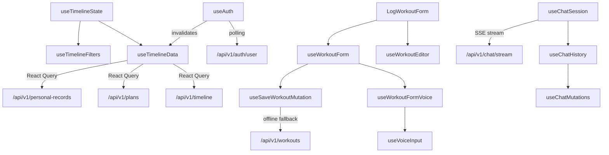
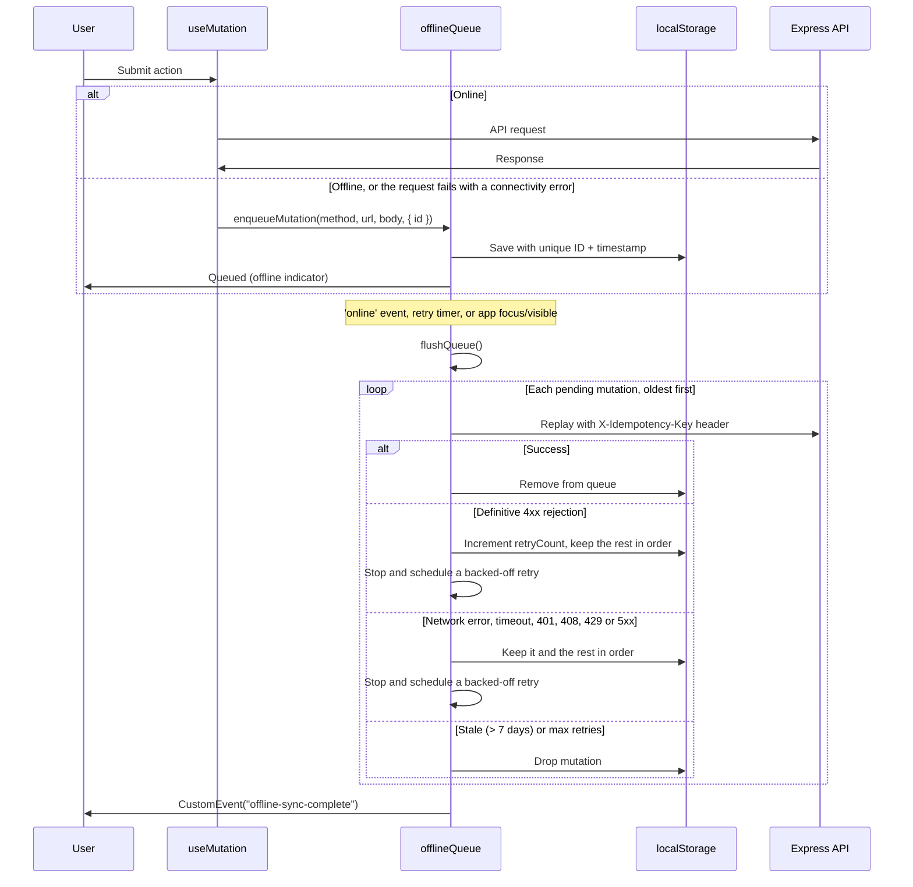

# State Management

[Back to README](../README.md)

## Overview

fitai.coach uses **TanStack Query (React Query v5)** for server state management and **local React state** (`useState`, `useRef`, `useCallback`, `useReducer`) for UI state. There is no global state store (Redux, Zustand, etc.). An offline mutation queue backed by localStorage provides resilience when the network is unavailable.

---

## Table of Contents

- [Query Client Configuration](#query-client-configuration)
- [API Client Layer](#api-client-layer)
- [Custom Hooks Catalog](#custom-hooks-catalog)
- [Offline Queue](#offline-queue)
- [Workout Draft Persistence](#workout-draft-persistence)
- [Utility Functions](#utility-functions)
- [Performance Patterns](#performance-patterns)

---

## Query Client Configuration

**File:** `client/src/lib/queryClient.ts`

```typescript
const queryClient = new QueryClient({
  defaultOptions: {
    queries: {
      queryFn: getQueryFn({ on401: "throw" }),
      refetchInterval: false,
      refetchOnWindowFocus: false,
      staleTime: 5 * 60 * 1000,  // 5 minutes
      retry: 1,                   // Single retry on failure
    },
    mutations: {
      retry: false,
    },
  },
});
```

### Key Design Decisions

- **5-minute stale time:** Reduces unnecessary refetches while keeping data reasonably fresh.
- **No window focus refetch:** Prevents jarring data refreshes when switching tabs.
- **Single retry:** Retries once on failure (e.g., transient network issues), then surfaces the error.
- **No mutation retry:** Mutations are not retried automatically to avoid duplicate side effects.

### Query Function

`getQueryFn({ on401 })` creates a typed query function that:
- Joins query key segments into a URL (e.g., `["/api/v1", "workouts"]` becomes `/api/v1/workouts`).
- Includes credentials (`credentials: "include"`) for Clerk JWT auth.
- Passes the query's abort `signal` to `fetch`, and throws through `throwIfResNotOk` on any other non-2xx response.
- Handles 401 responses based on the required `on401` parameter:
  - `"throw"` (what the shared `queryClient` passes) -- Throws an error, triggering React Query's error state.
  - `"returnNull"` -- Returns `null`, useful for optional auth checks. No caller passes it today.

### Instant-paint Snapshots (placeholderData + localStorage)

The expensive analytics surfaces (Coach Insights, Race Predictor, the Overview's AI chart analysis in `useOverviewAnalysis`, and MAF Trend) avoid a blank/spinner state on open by persisting their last result to `localStorage` and feeding it back as React Query `placeholderData`. The helpers live in `client/src/lib/analyticsSnapshot.ts`:

- `readAnalyticsSnapshot<T>(key)` / `writeAnalyticsSnapshot(key, value)` -- JSON get/set that swallow corrupt payloads and quota errors so a bad snapshot can never break the tab.
- `useWriteAnalyticsSnapshot(key, data, isPlaceholderData)` -- persists `data` whenever it changes and is *real* (skips the placeholder it just read back, and no-ops when `key` is `null`, e.g. signed out).

Snapshot keys are **scoped by `userId`** by the caller (e.g. `fitai-race-prediction-cache:<userId>`) so a previous account's data is never shown. The per-tab flow: read the per-user snapshot → pass as `placeholderData` → render instantly → the live query revalidates in the background → `useWriteAnalyticsSnapshot` writes the fresh result back. This pairs with the server's stored-first endpoints (see [API Reference — Analytics Routes](api-reference.md#analytics-routes)): the server returns the last persisted result with a `stale` flag, and the client paints it with no spinner.

### Custom Error Types

`queryClient.ts` exports two custom error classes thrown from `throwIfResNotOk`:

- **`RateLimitError`** -- Thrown on a 429 response. Extracts the `Retry-After` header (in seconds, or `null` if absent).
- **`AiBudgetExceededError`** -- Thrown on a 429 whose body carries `code: "AI_BUDGET_EXCEEDED"`. Carries `currentCostCents` and `limitCents` so the UI can explain the daily AI spend cap.

```typescript
class RateLimitError extends Error {
  readonly retryAfter: number | null;
}

class AiBudgetExceededError extends Error {
  readonly currentCostCents: number;
  readonly limitCents: number;
}
```

`resetCsrfToken()` is also exported here -- it clears the in-memory CSRF token cache on auth state transitions.

---

## API Client Layer

**Files:** `client/src/lib/api/client.ts`, `client/src/lib/queryClient.ts`

### Base Functions

- `apiRequest(method, url, data?, signal?, extraHeaders?)` -- Low-level fetch wrapper in `queryClient.ts`. Sets `Content-Type: application/json` when a body is present, includes credentials, handles error responses. Automatically attaches the `x-csrf-token` header on mutating requests (POST/PUT/PATCH/DELETE) and retries once with a fresh token on a 403 that may be a CSRF rejection (code `EBADCSRFTOKEN`, or no code at all); a 403 naming another code is not resent.
- `typedRequest<TResponse>(method, url, data?, options?)` -- Returns parsed JSON typed as `TResponse`. `options` accepts `timeoutMs` (default 15s), `signal`, and `headers`; the timeout is enforced via an `AbortController`. A call whose handler waits on an AI reply (exercise and meal parses, workout/plan-day reparse, nutrition-insight regeneration, the non-streaming chat fallback) passes `AI_REQUEST_OPTIONS` from `constants.ts` instead: 130 s, past the server's 120 s AI budget, so a slow parse is not abandoned while the server finishes and meters it. Strava and Garmin syncs allow 60 s.
- `rawRequest(method, url, data?, options?)` -- Returns the raw `Response` object (for streaming, file downloads). Same `options` as `typedRequest`.

### CSRF Token Management

The API client fetches a CSRF token from `GET /api/v1/csrf-token` before the first mutating request (the fetch is bounded to 10 s) and caches it in memory; nothing is fetched at startup. The token is automatically attached as the `x-csrf-token` header on all mutating requests. If a 403 CSRF error is received (e.g., after a Clerk sign-in invalidates the old token), the client refetches the token and retries the request once, transparently.

### Domain Modules

Each API domain has a dedicated module in `client/src/lib/api/`:

| Module | File | Functions |
|--------|------|-----------|
| Workouts | `workouts.ts` | `create()`, `latest()`, `get()`, `update()`, `updateBlockScore()`, `delete()`, `bulkDelete()`, `combine()`, `reparse()`, `reparseFromImage()`, `batchReparse()`, `history()`, `seedFromPlan()`, `assignPlanDay()`, device-link actions (`linkDeviceActivity()`, `unlinkDeviceActivity()`, `dismissDeviceLinkSuggestion()`), plus exercise-set CRUD and ordering (`addSet`/`updateSet`/`deleteSet`/`saveSetOrder` via `createExerciseSetMutationApi`) |
| Plans | `plans.ts` | `list()`, `get()`, `import()`, `createSample()`, `rename()`, `updateGoal()`, `setRetirement()`, `deletePlan()`, `generate()`, `getGenerationStatus()`, `schedule()`, `updateDayWithoutPlan()`, `setDayPriority()`, `getMissedRecovery()`/`applyMissedRecovery()`, `updateDayStatus()`, `deleteDay()`, `getDayExercises()`, `updateDayStructure()`, `addDayExercise()`/`updateDayExercise()`/`deleteDayExercise()`/`saveDayExerciseOrder()`, `reparseDay()`, `reparseDayFromImage()` |
| Coaching | `coaching.ts` | `chat` (`send()`, `sendStream()`, `saveMessage()`, `getHistory()`/`getHistoryPage()` (the saved conversation, newest page first with a cursor to the page before it), `clearHistory()`, `getWelcome()`, `setFeedback()`, `decideFactProposal()` (save or turn down a fact the coach offered), `getStoredCoachInsights()`, `regenerateCoachInsights()`), `coaching` materials (`list`/`listSummaries`/`create`/`delete`), `getRagStatus()`, `reEmbed()` |
| Analytics | `analytics.ts` | `analytics` (`getPersonalRecords()`, `getExerciseAnalytics()`, `getTrainingOverview()` — returns a `TrainingOverview` — `getTrainingSummary()`, `getOverviewAnalysis()`/`regenerateOverviewAnalysis()`, `getRacePrediction()`, `getWeeklyReview()`/`setWeeklyReviewIntent()`, `getSessionGrades()`/`getWorkoutSessionGrade()`, `exportData()`), `timeline` (`getPage()` — one cursor page of [`GET /api/v1/timeline`](api-reference.md#get-apiv1timeline) — `getSuggestions()`, `applySuggestion()`) |
| User | `user.ts` | `preferences.update()` (units, `userTimezone`, `weeklyGoal`, `mealSchedule`, `trainingConstraints: null` (removing the older injuries note), the email and push toggles, `showAdherenceInsights`, `aiCoachEnabled`, `coachAutoApplyPlanChanges`, `onboardingCompleted`, athlete profile / body composition, training-style and MAF fields), `strava.*` (`auth/disconnect/sync`), `garmin.*` (`connect/disconnect/sync`), `email.check()`. Reads of the current user and preferences go through the default query function, keyed by `QUERY_KEYS.authUser` / `QUERY_KEYS.preferences`, so they have no wrapper here |
| Exercises | `exercises.ts` | `parse()`, `parseStructured()`, `parseFromImage()`, `parseStructuredFromImage()`, `getHistory()` |
| MAF Tests | `mafTests.ts` | `tagWorkout()`, `updateTest()`, `untagWorkout()`, `list()` for MAF-test tagging and the MAF Trend tab |
| Timeline Annotations | `timelineAnnotations.ts` | `list()`, `create()`, `update()`, `delete()` for injury / illness / travel / rest bands |
| Athlete Facts | `athleteFacts.ts` | `list()`, `create()`, `update()`, `remove()`, `importNote()` for the athlete card; consumed through `client/src/hooks/useAthleteFacts.ts` (`QUERY_KEYS.athleteFacts`) |
| Plan Proposals | `planProposals.ts` | `getPending()`, `get()`, `apply()`, `undo()`, `dismiss()` for conversational plan-adjustment proposals |
| Recycle Bin | `recycleBin.ts` | `list()`, `restore()`, `restoreBatch()`, `purge()`, `empty()` for the 90-day soft-delete store |
| Consent | `consent.ts` | `recordServerConsent()` — records a consent grant/revocation server-side |
| Nutrition | `nutrition.ts` | The whole food-logging surface: search/recent/favourites, log CRUD + batch/repeat, custom foods and servings, recipes, barcode, the three AI parse calls, targets and per-meal overrides, micros, session fuelling and block view, insights. Consumed through `client/src/hooks/useNutrition.ts` — see [Nutrition & Fuelling § Client UI map](nutrition.md#6-client-ui-map) |

---

## Custom Hooks Catalog

The hooks below are in `client/src/hooks/` unless the File column gives another path; feature-specific hooks also sit beside the components and pages that use them (`client/src/components/**`, `client/src/pages/**`).

### Authentication and User

| Hook | File | Purpose |
|------|------|---------|
| `useAuth` | `useAuth.ts` | Integrates Clerk auth with database user sync. Polls the `authUser` query every 2s while `isAutoCoaching` is true (max 5 min, pauses while the tab is hidden). Invalidates timeline queries when auto-coaching completes. Resets the cached CSRF token on sign-in state transitions. Also exports `useIsAutoCoaching`, `useIsAiCoachEnabled`, `useIsOnboardingCompleted`, and `useIsAuthUserLoaded` -- thin `select`-based subscribers to single auth-user fields. |
| `useSignOut` | `useSignOut.ts` | Clerk sign-out. Calls `clearUserLocalData()` to purge the offline queue and workout drafts from local/session storage before signing out. `useConfirmedSignOut`, which the Log out button uses, asks first while offline writes are still queued. |
| `useEmailCheck` | `useEmailCheck.ts` | Fire-and-forget email check once per authenticated session (gated on `isAuthenticated` and `isAppUserLoaded`). |
| `useDetectTimezone` | `useDetectTimezone.ts` | Once authenticated, reads the browser's IANA timezone and PATCHes the stored `userTimezone` when the two differ (a new account's stored value is the default `UTC`), then invalidates the auth user. Runs once per mount. The server schedules emails and anchors weeks from that value. Fire-and-forget; failures are swallowed. |
| `useMafCeiling` | `useMafCeiling.ts` | The athlete's MAF aerobic ceiling in bpm, or `null` when they don't train to one. Reads the auth user query every surface already holds, so it adds no fetch. |

### Data Loading

| Hook | File | Purpose |
|------|------|---------|
| `useTimelineData` | `useTimelineData.ts` | Fetches plans, timeline entries, personal records and timeline annotations. The timeline is cursor-paged (`useInfiniteQuery`, keyed `[...QUERY_KEYS.timeline, selectedPlanId]`): the first page, then older ones through `loadOlderEntries`. Queued offline workout creates (`usePendingWorkoutEntries`) are appended to the entries. Manages scroll position and "go to today" navigation. Reports a failed load as `isError` (with `retry`), never as an empty account, so `isNewUser` stays false. A first fetch paused offline counts as loading, and `isError` stays set while a retry runs, with `isRetrying` true. |
| `useTimelineState` | `useTimelineState.ts` | Orchestrates timeline page state: the selected plan, plus `useTimelineData`, `useTimelineFilters`, `useOnboarding`, `usePlanImport`, `useWorkoutActions` and `useCombineWorkouts`. |
| `useUnitPreferences` | `useUnitPreferences.ts` | Reads the preferences query for the weight/distance units (default kg / km) and their labels, plus `showAdherenceInsights`. |
| `useExerciseHistory` | `useExerciseHistory.ts` | Past logged sets of one exercise, for the "Last time" line. Keyed on the canonical exercise name so aliases share a cache entry; held with a long `staleTime` and marked stale by every workout and set write. Skipped for custom exercises. |
| `usePendingWorkoutEntries` | `usePendingWorkoutEntries.ts` | Queued-but-unsynced workout creates as synthetic timeline entries, derived from the offline queue through `useSyncExternalStore` and refreshed on queue-change and sync-complete events. |

### Mutations

| Hook | File | Purpose |
|------|------|---------|
| `useApiMutation` | `useApiMutation.ts` | Generic wrapper around React Query's `useMutation`. Adds toast notifications (success/error), automatic query invalidation, and optional callbacks. A string `errorToast` is the title over `humanizeApiError`'s description; a `RateLimitError` or `AiBudgetExceededError` gets its own toast in place of `errorToast`. |
| `useWorkoutActions` | `useWorkoutActions.ts` | Timeline-entry action mutations: mark complete, skip, change status, delete workout/plan-day, and bulk delete (delegates to `workout-actions/useWorkoutActionMutations`). |
| `useChatMutations` | `useChatMutations.ts` | Save chat message, clear chat history mutations. |
| `useStravaMutations` | `useStravaMutations.ts` | Strava connect (fetches the OAuth URL and redirects to it), disconnect and sync mutations. A sync failure naming `STRAVA_REAUTH_REQUIRED` toasts "Strava reconnection needed". |
| `useGarminMutations` | `useGarminMutations.ts` | Garmin connect (email/password), disconnect, and manual sync mutations. The hook reads no Garmin error codes itself; failures toast through `useApiMutation`, so a 4xx (the 409 `GARMIN_BUSY`) shows the server's own message, the 429 `GARMIN_SYNC_TOO_SOON` the generic "Too many requests" toast, and a 5xx (the 503 `GARMIN_CIRCUIT_OPEN`) the generic server-error line. |
| `useCoachingMaterials` | `useCoachingMaterials.ts` | The coaching-material summaries list, with `useCreateCoachingMaterial`, `useDeleteCoachingMaterial`, `useRagStatus` and `useReEmbed` beside it. |
| `useDeviceLinkMutations` | `useDeviceLinkMutations.ts` | The athlete's override of the sync's matcher, from the timeline card: merge a standalone device import into the planned session or logged workout it belongs to, split a linked recording back out, or wave off a suggestion. Success refetches everything the recording moved between. |

Timeline annotations are read in `useTimelineData` and written through `useTimelineAnnotationMutations` (create, update, delete) in `client/src/components/timeline/annotations/useTimelineAnnotationMutations.ts`, which `AnnotationsDialog` uses; the same file exports `useTimelineAnnotations` for the dialog's own list. Deleting an annotation from its timeline row goes through a mutation in `client/src/pages/timeline/useTimelinePageController.ts`. The annotations list is small and refetches cheaply on mutation. Account deletion is invoked from `client/src/components/settings/AccountDangerZone.tsx`, which calls the `DELETE /api/v1/account` endpoint from a confirm dialog that stays disabled until the athlete types `DELETE`. On success it calls `clearUserLocalData()`, toasts, and 1.5 s later sets `window.location.href = "/"`: the full reload drops all client state, and the session is no longer valid.

### Forms and Editors

| Hook | File | Purpose |
|------|------|---------|
| `useWorkoutEditor` | `useWorkoutEditor.ts` | Manages exercise blocks for the LogWorkout page. Handles adding/removing/reordering exercises (dnd-kit integration), parsing text into exercises, and tracking block state. |
| `useWorkoutForm` | `useWorkoutForm.tsx` | Manages workout form state (date, focus, RPE, notes, duration). Handles submission with exercise data. |

### Chat and Coaching

| Hook | File | Purpose |
|------|------|---------|
| `useChatSession` | `useChatSession.ts` | One coach chat surface: the message buffer, `sendMessage` (SSE streaming with `requestAnimationFrame` batching, RAG info and safety-notice tracking) and failed sends (turns saved once the server accepts them, failure notes worded by `describeChatFailure`, and `retryMessage`). Composes the `chat/` hooks below; the SSE request lives in `chat/chatStream.ts`, which reads the stream through `consumeSSEStream` (`client/src/lib/sseStream.ts`, where the `requestAnimationFrame` batching is), and the pure history, turn-saving and failure rules in `chat/chatSessionModel.ts`. Without `ReadableStream` it falls back to the non-streaming `POST /api/v1/chat`. |
| `useChatHistory` | `chat/useChatHistory.ts` | Loads the saved conversation once into the chat buffer, keeping any message sent before it arrived (CL41), and clears it; the server saves the turns. |
| `useChatAutoScroll` | `chat/useChatAutoScroll.ts` | Keeps the chat viewport pinned to the newest message while the athlete is at the bottom. |
| `useBudgetWarning` | `chat/useBudgetWarning.ts` | One toast per session when a chat response carries `X-AI-Budget-Warning`. |
| `useOlderChatHistory` | `chat/useOlderChatHistory.ts` | The "Load older messages" control: fetches the page before the oldest one shown, from the cursor the newest page carried, and puts it ahead of the saved messages in the buffer. |
| `useMessageFeedback` | `chat/useMessageFeedback.ts` | The athlete's thumbs on a coach reply: shown at once, saved in the background (a 404 is tried once more after 1 s, since the reply may not be saved yet), and put back with a toast if the save fails. |
| `useFactProposalDecision` | `chat/useFactProposalDecision.ts` | Save or turn down a fact the coach offered under a reply: shown at once, put back with a toast if the server refuses it, then invalidates the chat history and, on a save, `QUERY_KEYS.athleteFacts`. |
| `usePlanProposal` | `usePlanProposal.ts` | The pending plan-adjustment proposal and its apply, dismiss and undo actions. Query-driven, so a pending proposal reappears after a reload. Also exports `useLiveProposal`, which keeps a proposal's card at its chat turn in step with its current status. |

### Analytics

| Hook | File | Purpose |
|------|------|---------|
| `useRacePrediction` | `components/analytics/useRacePrediction.ts` | Fetches the stored HYROX race prediction with instant paint (`placeholderData` from a per-user localStorage snapshot, see [Instant-paint Snapshots](#instant-paint-snapshots-placeholderdata--localstorage)). Exposes a manual `refresh()` that forces server regeneration via `?refresh=1` and writes the fresh result back into the query cache. |

### Plans

| Hook | File | Purpose |
|------|------|---------|
| `useGeneratePlan` | `usePlanGeneration.ts` | AI plan generation: `POST /api/v1/plans/generate` returns a stub plan, then the hook polls its generation status every 3 s until the plan is ready or failed, the status has been unreachable for 30 s, or 20 minutes have passed. A ready plan is loaded, plans and timeline are invalidated, and the caller's `onSuccess` runs. |
| `usePlanImport` | `usePlanImport.ts` | CSV file import with validation and preview, plus the other plan mutations the Timeline uses: sample plan, rename, goal, retirement, delete and schedule. |

### UI State

| Hook | File | Purpose |
|------|------|---------|
| `useTimelineFilters` | `useTimelineFilters.ts` | The timeline's status filter (held in `?status=` through `useUrlQueryState`), the past and future date groups it leaves, and the "show more" state that reveals more than the first 7 groups each way. The selected plan lives in `useTimelineState`. |
| `useOnboarding` | `useOnboarding.ts` | Tracks durable onboarding completion with a local fallback that holds the signed-in athlete's id (`onboardingStorage.ts`), so another account on the device neither skips onboarding nor is marked complete by it. |
| `useEnableAiCoach` | `useEnableAiCoach.ts` | Mutation that turns `aiCoachEnabled` on (the consent every AI route checks) and refreshes the auth user and preferences. Used by the AI plan generator's consent step. |
| `useOnboardingWizard` | `useOnboardingWizard.ts` | Multi-step wizard state and navigation. The form is a draft over the athlete's saved preferences (`onboardingProfile.ts`), and each step writes only the fields that differ from what is saved, so "Run setup again" never resets an established athlete's settings. |
| `useCompleteOnboarding` | `useCompleteOnboarding.ts` | Returns the callback that marks onboarding complete: the per-athlete local flag at once, then the server flag in the background. Also exports `useOnboardingUserId`. |
| `useOnlineStatus` | `useOnlineStatus.ts` | Tracks `navigator.onLine` with event listeners. |
| `useOfflineDropNotifier` | `useOfflineDropNotifier.ts` | Subscribes to the offline queue and shows a destructive toast whenever a queued mutation is permanently dropped (data loss). Mounted once near the app root. |
| `useCombineWorkouts` | `useCombineWorkouts.ts` | State for merging multiple workout logs into one. |
| `useOpenWorkoutId` | `useOpenWorkoutId.ts` | Which workout sheet is open, held in the `?workout=` query parameter so the browser's back button closes it. Opening pushes a history entry; clearing replaces. |
| `useUnsavedChangesPrompt` | `useUnsavedChangesPrompt.ts` | Intercepts in-app link clicks and the back button while a form has unsaved changes, and holds the navigation until the athlete confirms or cancels. Settings uses it through `pages/settings/useSettingsUnsavedChangesGuard.ts`. |
| `useDocumentTitle` | `useDocumentTitle.ts` | Sets `document.title` for the current page, so each route announces itself to assistive technology. |
| `useFocusMainOnRouteChange` | `useFocusMainOnRouteChange.ts` | Moves focus to `#main-content` on client-side route changes (WCAG 2.4.3), which wouter does not do. The first render is skipped so page load leaves the skip link alone. |
| `use-toast` | `use-toast.ts` | Toast notification state management. |
| `use-mobile` | `use-mobile.tsx` | Responsive breakpoint detection. |

### Voice Input

| Hook | File | Purpose |
|------|------|---------|
| `useVoiceInput` | `useVoiceInput.ts` | Web Speech API integration. Manages microphone permissions, speech recognition start/stop, transcript accumulation, and error handling. `stopListening` calls the recogniser's `stop()`, which still returns a final result for the audio captured so far; its optional `onStopped` callback runs once that result has been emitted, so a caller that needs the complete text (the log-workout stepper's Continue) waits for it. Words shown but never finalised are committed when the stopped recogniser ends, or after 2 s if it does not, and nothing it sends after that is taken. |

Additional feature hooks not catalogued above include `useWorkoutDetail`, `usePlanDayExercises`, `useExerciseSetsForOwner` (with `useDebouncedSetPatches` and `useSetOrderSave` behind it), `useMoveTimelineEntry`, `useLogWorkoutDraft`, `usePushNotifications`, `useUrlQueryState`, `useDebouncedCallback`, `useFlushOnPageHide` (calls a flush on `visibilitychange` to hidden and on `pagehide`), `useNavigationBreadcrumb` (adds a Sentry navigation breadcrumb on each route or query-string change), `useOfflineQueueFlush` (see [Auto-flush](#auto-flush)), and the query-and-mutation sets in `useNutrition.ts`, `useAthleteFacts.ts`, `useRecycleBin.tsx` (which also exports `useUndoDeleteToast`), `useSessionGrades.ts` (`useSessionGrades`, and `useWorkoutSessionGrade`, which re-reads every 30 s, at most 10 times, while the grade's stream is pending) and `useWeeklyReview.ts` (`useWeeklyReview`, keyed by the week's Monday, and `useSetWeeklyReviewIntent`, which invalidates that week and the next). `useMissedRecovery.ts` holds the missed-session recovery hooks: `useMissedRecoveryPreview` (uncached — the preview depends on today and the rest of the week, so it is refetched every time the sheet opens), `useApplyMissedRecovery` (invalidates the timeline, training overview, plans, weekly review, every day's nutrition summary and the day's cached exercise sets — shortening drops or scales them, and undoing it puts them back; a 404/409 refreshes the timeline and the open preview; an `undoing` variable lets the toast say where an undone move went) and `useSetSessionPriority` (optimistic tier change on the cached timeline entry, rolled back on error). Related hooks and their helpers are also grouped under the `chat/`, `voice/`, `workout-editor/`, `workout-form/`, and `workout-actions/` subdirectories of `client/src/hooks/`.

### Hook Dependency Tree



---

## Offline Queue

**File:** `client/src/lib/offlineQueue.ts`

A localStorage-backed mutation queue. Writes opt in through `runWithOfflineFallback` (`client/src/lib/offlineMutationFallback.ts`), which enqueues instead of sending when the browser is offline, or when the live call fails with a connectivity-shaped error (application 4xx/5xx errors are rethrown, not queued). Three writes use it:

- workout-log creates — `POST /api/v1/workouts`, from /log (`useSaveWorkoutMutation`) and from a planned session ticked off on the timeline or with LogSheet's "Log workout" (`useWorkoutActionMutations`). A queued planned-session log takes the planned row off the cached timeline for the session, since the pending-workout overlay already shows the queued log (CL55);
- plan-day status changes, skips included — `PATCH /api/v1/plans/days/:dayId/status` (`useWorkoutActionMutations`), whose optimistic timeline flip stays in place for the session while the change is queued;
- food-log creates — `POST /api/v1/nutrition/logs` (`useLogFood`).

All other mutations use direct server requests.

### Design

- **Queue storage:** `localStorage` under the key `fitai-offline-queue`, with the owning user's id beside it under `fitai-offline-queue-owner`. Each entry holds `id`, `method`, `url`, `body`, `timestamp`, `retryCount` and `serverErrorCount`.
- **Max queue size:** 100 mutations (oldest evicted when full, announced as `queue_overflow`).
- **Max age:** 7 days -- stale mutations are dropped during flush.
- **Max retries:** 5 definitive rejections per mutation -- the flush after the fifth drops it instead of sending it again. Only a 4xx that a retry won't change counts: not a 401 (session lapsed while offline), 408, 429, a 409 `IDEMPOTENT_REQUEST_IN_PROGRESS` or a 403 `EBADCSRFTOKEN`. Network errors, timeouts and 5xx keep the mutation's count, so a flaky connection can't drop it; the max age still bounds those. A plain 500 counts toward a separate cap of 20 instead (502/503/504 never count): because a replay stops at a failed entry, a write the server fails every time would otherwise hold everything queued behind it for the full 7 days.
- **Ordering:** Replay goes one mutation at a time, oldest first, and stops at the first one that fails. The mutations behind it stay queued in order, so a newer edit to the same record can never land before an older one.
- **Replay timeout:** Each replay request is abandoned after 30 s and counts as a failure with no answer (it keeps its retry count), so a request the server never answers can't hold the run, and every flush that joins it, until a reload. The retry reuses the idempotency key, so a write the server did commit is not applied twice (CL57).
- **Idempotency:** Each queue-backed write generates a crypto-backed unique ID before the first request, sends it as `X-Idempotency-Key`, and reuses it if the body is queued for replay. The server enforces idempotency via the `idempotencyMiddleware`, which caches responses in the `idempotency_keys` database table with a 7-day TTL.
- **Privacy cleanup:** Signout and account deletion clear queued mutation bodies and user-scoped drafts from browser storage. While writes are queued, the Log out button asks first (`useConfirmedSignOut`), since signing out deletes them; a different athlete signing in still drops them without asking, announced as `wrong_account` (CL61).

### API

| Function | Description |
|----------|-------------|
| `enqueueMutation(method, url, body, options?)` | Adds a mutation to the queue (`options.id` overrides the generated ID). Returns the mutation ID. |
| `getPendingCount()` | Returns the number of queued mutations. |
| `getPendingMutations()` | Read-only snapshot of the queued mutations, for the timeline's pending-entry overlay (`usePendingWorkoutEntries`). |
| `flushQueue()` | Replays pending mutations in order, stopping at the first failure. Returns `{ synced, failed, dropped }`. A call made while a flush is running joins that run; if the run ends without a failure, one follow-up flush sends what was queued meanwhile. |
| `reconcileQueueOwner(userId)` | Stamps the signed-in user as the queue's owner, first dropping a queue another user left (announced as `wrong_account`). A `null` user is ignored. |
| `releaseQueueOwner()` | Holds the timer and focus retries until the next `reconcileQueueOwner`. |
| `clearOfflineQueue()` | Removes the queued mutation bodies and the owner stamp from localStorage, cancels a pending retry and notifies listeners. |
| `createOfflineMutationId()` | Generates a crypto-backed unique mutation ID (`crypto.randomUUID()` with a `getRandomValues` fallback). |
| `onMutationDropped(cb)` | Registers a callback fired whenever a mutation is permanently dropped, with the reason: `max_retries`, `max_age`, `queue_overflow`, `storage_full` or `wrong_account`. Returns an unsubscribe function. Used by `useOfflineDropNotifier`. |

### Auto-flush

When the browser fires the `online` event, `flushQueue()` runs automatically and the retry backoff starts again from 5s. `useOfflineQueueFlush(userId)`, mounted in `AuthenticatedLayout`, covers a tab that was closed offline and reopened online: on mount and whenever the user id changes it calls `reconcileQueueOwner(userId)` and then flushes if the browser is online and writes are pending. A device that never went offline gets no `online` event (a save queued after a timeout on slow wifi, say), so while mutations are pending and the browser reports online the queue also retries on a timer (5s, doubling after each replay that stopped on a failure, capped at 5 minutes) and when the app regains focus or becomes visible. The timer and focus/visibility retries run only while `reconcileQueueOwner` has confirmed the signed-in user: `useOfflineQueueFlush` releases that confirmation (`releaseQueueOwner()`) when the user signs out or switches, and `clearOfflineQueue()` cancels any pending retry. The `online` handler does not check the confirmation. Queue writes dispatch the `OFFLINE_QUEUE_CHANGE_EVENT` (`"offline-queue-change"`); replays that synced or dropped at least one mutation dispatch the `OFFLINE_SYNC_COMPLETE_EVENT` (`"offline-sync-complete"`) for the UI to react. Its detail lists the URL and method of each request that synced; `OfflineIndicator` passes them to `invalidateForSyncedRequests` (`client/src/lib/offlineInvalidation.ts`), which invalidates the workout reads, the nutrition reads, or both, by URL. Both event names are exported constants.

### Error Handling

- `QuotaExceededError` on save: Evicts the oldest half of the queue, retries once, then clears entirely if still failing. Every evicted mutation is announced as dropped (`storage_full`).
- Corrupted localStorage: Returns empty queue (gets overwritten on next save). One stored entry of the wrong shape rejects the whole stored queue.
- Individual mutation failures: the replay stops there and keeps that mutation and everything after it for the next retry. A definitive rejection increments its `retryCount` and a plain 500 its `serverErrorCount`; any other failure leaves both unchanged. A replay still in flight when the queue is cleared (sign-out) or dropped for another athlete doesn't write its leftovers back.

### Offline Queue Lifecycle



---

## Workout Draft Persistence

**File:** `client/src/hooks/useLogWorkoutDraft.ts`

The Log Workout page autosaves a working draft to `localStorage` so an accidental refresh or navigation does not lose in-progress data.

- **Storage keys:**
  - `fitai-log-workout-draft:<userKey>` — the draft payload, in `localStorage` (durable across sessions and tabs). A draft whose stored `userKey` does not match is ignored.
  - `fitai-log-workout-draft-announced:<userKey>` — a per-tab flag in `sessionStorage` that suppresses re-showing the "Draft restored" toast more than once within the same browser session. Scoped to `sessionStorage` deliberately so a fresh tab announces the restore again.
- **Schema version:** `DRAFT_VERSION = 5` (v5 added the manual session start time `timeOfDayMin`, v4 `distance` / `avgHeartrate` / `maxHeartrate`, v3 `durationMinutes`). Drafts written under v2–v4 still load, with the missing fields hydrated as blank/null; any other version (v1) is discarded on load.
- **Restoring:** A restored draft resumes on the step it was left on, under a notice (`RestoredDraftNotice`) that names the date the save will use, offers "Use today's date" when that date is not today, and a "Discard draft" that clears it and starts a blank form (CL44).
- **Lifetime:** Drafts persist **indefinitely** until they are explicitly cleared. The hook stores `savedAt: Date.now()` but never checks the timestamp for expiry — clearing only happens when the user successfully saves the workout, discards it from the restored-draft notice, empties the form (a blank draft is removed rather than saved), signs out (via `clearUserLocalData()` in `client/src/hooks/useSignOut.ts`), or deletes their account (via `AccountDangerZone`). This is intentional, since the draft is single-user device-local state with no privacy retention concern beyond the signout/deletion paths that already clear it.

---

## Utility Functions

### Date Utilities

**File:** `client/src/lib/dateUtils.ts`

| Function | Description |
|----------|-------------|
| `getTodayString()` / `getYesterdayString()` | The local calendar date as `YYYY-MM-DD` |
| `getLatestLoggableDateString()` | Tomorrow's local date, the latest day a workout can be logged on or moved to |
| `toISODateString(date)` | Converts a Date to its local `YYYY-MM-DD` |
| `getStartOfWeek(date, weekStartsOn = 1)` / `getEndOfWeek(...)` | Monday / Sunday of the given week (Monday-start by default, audit L7) |
| `getStartOfWeekString(...)` / `getEndOfWeekString(...)` | The same, as `YYYY-MM-DD` |
| `isDateInRange(date, start, end)` | Inclusive range check on `YYYY-MM-DD` strings |
| `formatTime(date)` | A Date's local time with two-digit hour and minute, in the browser's locale format (`toLocaleTimeString`) |
| `getCurrentTimeString()` | `formatTime(new Date())` |

### Exercise Utilities

**File:** `client/src/lib/exerciseUtils.ts`

| Function | Description |
|----------|-------------|
| `groupExerciseSets(sets)` | Sorts sets by `sortOrder` and groups consecutive ones that share an exercise (and, inside a structure block, a block step) |
| `formatExerciseSummary(group, weightUnit, distanceUnit)` | One group as a line: its label, then sets × reps, weight, distance and time where present (`Back Squat 3x10 40kg`), in the athlete's units |
| `getExerciseLabel(name, customLabel?)` | Returns display name: the custom label when there is a usable one, else the exercise definition's label |
| `exerciseSetsToStructured(sets, options?)` | Stored sets as the editor's `StructuredExercise` blocks (`{ names, data }`) |
| `categoryChipColors`, `categoryLabels` | Per-category chip colour classes and display labels |

Performance: `getUniqueWeights` uses a `Set` for O(1) membership checks instead of `Array.includes()`.

### Stats Utilities

**File:** `client/src/lib/statsUtils.ts`

| Function | Description |
|----------|-------------|
| `calculateStats(timeline)` | One pass over the timeline entries → `TrainingStats` for the Coach panel: `workoutsThisWeek` / `completedThisWeek` (Monday-start week, matching the server), `plannedUpcoming`, and a `completionRate` over the finished days of the last 4 weeks (`COMPLETION_RATE_WINDOW_DAYS`, which the Timeline's first page holds, so "Load older workouts" does not move it; the panel labels it "4wk rate") — today, `excused` days and missed sessions the athlete let go are left out, and it is `null` when nothing came due in the window |
| `formatSecondsToMmSs(seconds)` | A split as `M:SS` (272 → `4:32`) |
| `formatSecondsToClock(seconds)` | Re-exported from `shared/formatClock.ts`: a duration as `H:MM:SS` |

Personal-record, exercise-analytics, weekly-summary and category-total calculations are server-side, in `server/services/analyticsService.ts`.

---

## Performance Patterns

### Single-pass Array Traversals

Throughout the codebase, multiple data transformations are combined into single array passes instead of chaining `.filter().map().reduce()`. This avoids creating intermediate arrays.

### Set-based Lookups

Exercise name lookups use `Set` instead of `Array.includes()` for O(1) membership checks:

```typescript
// server/prompts.ts
export const VALID_EXERCISE_NAMES = new Set<string>(exerciseNames);

// server/gemini/exerciseParser/mapping.ts -- O(1) instead of O(n)
const isKnown = VALID_EXERCISE_NAMES.has(exercise.exerciseName) && exercise.exerciseName !== "custom";
```

### requestAnimationFrame Batching

The coach chat batches SSE text chunks using `requestAnimationFrame` to prevent excessive React re-renders during streaming. The batching is in `consumeSSEStream` (`client/src/lib/sseStream.ts`), which `useChatSession` reaches through `streamChatReply` (`client/src/hooks/chat/chatStream.ts`): each chunk read from the stream is folded into an accumulator, and the consumer's `onFlush` runs at most once per animation frame with the text so far.

```typescript
// Each read adds to the accumulator, then asks for a flush
for (const event of events) {
  processSSELines(event.split("\n"), acc, options.metaKey, options.extraKeys);
}
scheduleFlush();
```

### requestAnimationFrame Batching Detail

`consumeSSEStream` schedules one flush per frame, and `createMessageUpdater` (`client/src/hooks/chat/chatSessionModel.ts`) writes each flushed snapshot into the assistant message:

```typescript
// From client/src/lib/sseStream.ts
const acc = { content: "", meta: undefined, extras: {} };
let rafId = 0;
let dirty = false;
let aborted = false;

const flush = () => {
  if (!dirty || aborted) return;
  dirty = false;
  options.onFlush({ content: acc.content, meta: acc.meta, extras: acc.extras });
};

const scheduleFlush = () => {
  if (!dirty) {
    dirty = true;
    rafId = requestAnimationFrame(flush);
  }
};

// From client/src/hooks/chat/chatSessionModel.ts
setMessages((prev) =>
  prev.map((m) =>
    m.id === assistantMessageId
      ? { ...m, content: snapshot.content, ...(snapshot.meta ? { ragInfo: snapshot.meta } : {}), ...streamExtras(snapshot.extras) }
      : m,
  ),
);
```

Without batching, each chunk read from the stream would trigger a React state update + re-render. With rAF batching, the chunks that arrive within one animation frame are flushed together. When the stream ends the pending frame is cancelled and one last flush runs; an aborted stream (Stop, or the chat surface unmounting) skips it, and `streamChatReply` drops flushes from a superseded send.

### Parallel Data Fetching

Independent data fetches use `Promise.all()` to run concurrently. On the server, `buildTrainingContext` (`server/services/ai/index.ts`) reads everything the coach's context needs in one batch:

```typescript
const [
  timeline,
  activePlanRecord,
  upcomingDays,
  loadWorkoutLogs,
  loadExerciseSets,
  loadTags,
  annotations,
  activeFacts,
] = await Promise.all([
  storage.timeline.getTimeline(userId, undefined, AI_CONTEXT_TIMELINE_LIMIT),
  storage.plans.getActivePlan(userId),
  storage.timeline.getUpcomingPlannedDays(userId, 7),
  storage.analytics.getWorkoutLogsByDateRange(userId, loadHistoryStart, today),
  storage.analytics.getAllExerciseSetsWithDates(userId, loadHistoryStart, today),
  storage.analytics.getExerciseLoadTags(),
  storage.timelineAnnotations.list(userId),
  storage.athleteFacts.listActive(userId),
]);
```

On the client, mutation handlers invalidate their query keys the same way (`useApiMutation` awaits `Promise.all` over `invalidateQueries`).

### Query Stale Time

The 5-minute stale time prevents redundant API calls when navigating between pages, as cached data is reused without refetching.

---

## Key Files

| File | Purpose |
|------|---------|
| `client/src/lib/queryClient.ts` | QueryClient config, RateLimitError, apiRequest |
| `client/src/lib/apiError.ts` | `parseApiError`: the status and error code of a failed `apiRequest` (thrown as `${status}: ${body}`). `humanizeApiError`, the offline queue, the workout save, Settings, the plan-proposal 409 and chat 404 checks, the chat failure copy (`chatErrors.ts`), the missed-session recovery 404/409 check, the favourite un-star 404, the plan-day exercise parse (`usePlanDayExercises`) and the exercise-set 409 check (`exerciseSetVersionLock.ts`) all read the status or code through it rather than a private copy (CL34) |
| `client/src/lib/offlineQueue.ts` | Offline mutation queue |
| `client/src/lib/api/client.ts` | typedRequest / rawRequest base functions |
| `client/src/lib/api/*.ts` | Domain-specific API modules |
| `client/src/hooks/*.ts` | All custom React hooks |
| `client/src/lib/dateUtils.ts` | Date formatting and predicates |
| `client/src/lib/exerciseUtils.ts` | Exercise data helpers |
| `client/src/lib/statsUtils.ts` | Coach panel training stats, split/clock formatting |

---

See also: [Client -- Component Architecture](client.md#component-architecture), [API Reference](api-reference.md), [Architecture -- Request Lifecycle](architecture.md#2-request-lifecycle)
